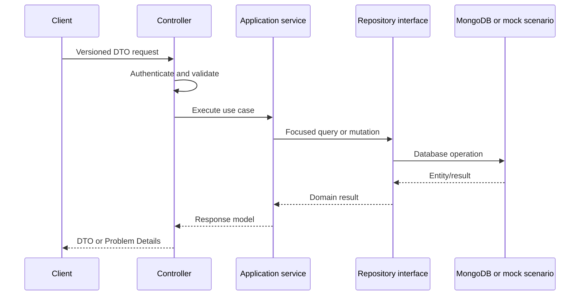

# Backend Architecture

## Composition

Each API is an independent ASP.NET Core host. Startup selects feature flags, configuration providers, authentication, repositories, services, health checks, and middleware.

Production persistence uses Mongo repositories. Development/test may select code-initialized mock repositories through the Domain-owned `IMockScenarioLifecycle`; the default is `Primary`, with named scenario selection from startup configuration and fixture overrides. Mock selection is rejected outside Development or Test, and production registrations continue to construct Mongo/external providers only when mock mode is off.

## Request Flow

Focused services for content, catalog, shop, forms, insights, links, and publishing are now in place. High-impact BackOffice paths (`ShortLinksController`, `VideosController`, `CompilationsController`) are service-based and covered by focused dependency tests; remaining legacy controller migrations proceed incrementally. `DataService` and `IGenericDataService` remain compatibility surfaces for controllers not yet migrated.

Video enrichment/refresh fetches attached reference IDs, not thumbnail IDs,
and preserves attachment order, categories, channel IDs, creation timestamps,
and references absent from provider results. Provider-owned aggregate metadata
is refreshed only for one reference whose ID equals the aggregate `ContentId`,
the identity created by single import. Editorial aggregate text/URL/thumbnail
is otherwise retained; presentation cardinality does not transfer ownership
of that text. Video mutations also reset calendar memory entries and purge the
calendar output tag because reference count and URL affect enriched destinations.
Append/compensation invalidation reports degradation through the existing
cache helper, including when compensation cannot remove the persisted append.

## Public Accounts

ServerAPI public accounts are a separate Domain-owned boundary backed by `PublicAccount` and `PublicAccountSession` collections. The dedicated cookie scheme revalidates the hashed session token and account security version on each authenticated request. Controllers expose only Contracts DTOs; registration, login, profile mutation, and logout require CSRF validation, while existing anonymous content and push routes remain unchanged.

## FreezerAnalysis API

`FreezerAnalysis.Api` is an independent .NET 10 host for the FreezerAnalysis application. It composes the existing `IPublicAccountService` against the platform account database and uses the separate `FreezerAnalysis:ApplicationDatabaseName` for feature collections. Startup rejects missing or colliding database configuration. Its `freezer_account_session` cookie is host-only and distinct from ServerAPI's account cookie; users authenticate independently at this host rather than relying on cross-host cookie sharing. Unsafe account/session requests require the feature's CSRF cookie/header pair.

Production authentication and repositories are the defaults. The host uses the shared `FeatureManagement:EnableMock` and `FeatureManagement:EnableDev` flags, with Development defaults selecting development authentication and the in-memory feature repository without MongoDB. Request-facing repositories and feature services are scoped; Mongo/blob clients and database accessors remain singleton infrastructure. Mock mode is rejected outside Development/Test. The host owns the feature's import, draft, freeze, field-event, and artifact endpoints; it does not reference ServerAPI or BackOffice.

Shooter identities are account-owned records in the FreezerAnalysis database. A revision-checked account/match/result mapping links a published participant result to one identity without modifying the shared immutable score fact. Exact normalized names and explicitly supplied aliases only suggest candidates; the user must confirm every mapping. Profile and draft identity references are validated against the current account. This is intentionally not a cross-account identity-sharing or licensing workflow.

The [2026-10-24 API consistency audit](api-consistency-audit.md) consolidates the common standard, source-verified exceptions and bounded correction order. In particular, focused service registration does not prove that duplicated form submission invariants or all mock-mode controller dependencies are aligned.

## Persistence

### MongoDB

- `BaseRepository<T>` implements generic CRUD.
- Specialized repository interfaces identify collections and feature queries.
- Updates commonly replace complete documents.
- Source-managed Mongo index audit/apply operations exist via BackOffice (`MongoIndexesController`, `MongoIndexOperationsService`). ServerAPI and BackOffice also verify/create only the blog-interaction indexes before accepting traffic in Mongo mode; mock mode skips this startup service. Other indexes remain manually applied. See [ADR-022](adr/ADR-022-startup-blog-index-bootstrap.md).
- `BsonIgnoreExtraElements` supports additive compatibility for many entities.
- User lookups must use the repository ID path, which supports legacy BSON `ObjectId` and string `_id` values; do not apply string operators such as `ToLower()` to `User.Id` in Mongo predicates.

Full collection materialization and in-memory sorting/filtering bypass Mongo indexes. New repository methods must push predicates, projections, ordering, limits, and atomic updates into MongoDB.

### Mock Data

Current mock repositories are code-initialized, in-memory entity collections loaded through the `IMockScenario`/`PrimaryScenario` abstraction, not JSON files. They support deterministic local behavior without MongoDB. External integrations also need fake implementations so full workflows can run offline. See [Development](development.md).

### SQLite

VideoImporter uses EF Core SQLite for local settings, tenant state, and scheduling. Schema changes require forward and rollback-aware migrations and must preserve existing local databases.

### VideoImporter channel settings

BackOffice owns the channel-authoritative `videoImporterChannelSettings` aggregate. Its versioned JSON payload is client-owned opaque data; the repository reads and atomically upserts by the channel resolved from `X-Channel-Id`. The unique `channelId` index is source-managed in `MongoIndexOperationsService` and is applied only through the reviewed manual index operation after duplicate audit.

The v1 importer snapshot allowlists application name, default hashtags, languages/disclaimers by language code, and publish schedules by value. SQLite remains a tenant-filtered working cache; the importer writes remotely before projecting acknowledged values in one local transaction. Bootstrap credentials, channel selection, social tokens, history, machine paths, and local row IDs are excluded. See [ADR-021](adr/ADR-021-video-importer-channel-settings.md).

## Authentication And Authorization

### BackOffice

- JWT bearer is the principal scheme.
- JWT bearer remains the authentication scheme for the API, and its handler can read the secure `auth_token` cookie.
- BackOffice browser clients use that cookie only; the SPA does not persist or emit a JWT Bearer token.
- Selected machine endpoints use the `ApiKey` scheme.
- Anonymous access must be explicit and limited to genuine bootstrap/login/submission cases.
- `POST /api/auth/validate` preserves its existing `userId` response and returns normalized, expanded `effectivePermissions`, resolved from direct permissions union active `UserGroup` memberships. This cookie-backed response is the SPA route-guard authority; localStorage is never an authorization source.
- Domain security owns lowercase-invariant, cycle-safe, transitive permission expansion through an explicit mapping. Each declared `<resource>.manage` implies only its reviewed sibling capabilities. Specialized implications are `users.permissions.manage`, `videos.import`/`videos.translate`/`videos.publish`, `forms.responses.view`, and `insights.scan`; `images.manage` has no update leaf and `diagnostics.view` is standalone. Leaves never imply parents, siblings, or other resources.
- `backoffice.manageall` remains the global evaluator/frontend bypass and materializes only `backoffice.access`, not every catalog permission. Persisted parent grants require no migration; auth validation and RBAC summaries expose implied leaves in their existing effective-permission arrays.
- RBAC owns Mongo `UserGroup` documents and the many-to-many relationship represented by user `GroupIds`. Legacy `Role` and `CanAccessBackoffice` data remain readable, with the latter mapped to canonical lowercase `backoffice.access`.
- `backoffice.access` is limited to login and BackOffice entry. RBAC user-list and detail reads require `users.view`; user lifecycle mutations require their corresponding `users.create`, `users.update`, or `users.delete` leaf; group CRUD, memberships, and direct-permission assignments require `users.permissions.manage`. `users.manage` implies these reviewed user-administration capabilities, and `backoffice.manageall` remains the global override.
- `AllowUser` supports `group:` and `perm:` tokens as well as unprefixed OR semantics, and all group/permission comparisons use lowercase invariant normalization.

### Channel tenancy

BackOffice channel selection is explicit. `GET /api/channels/accessible` returns the channels accessible to the effective identity (owned channels for contributors, full access for administrators); scoped resources require `X-Channel-Id`. `GET /api/channels` and channel creation are global administration operations requiring `channels.admin`; `backoffice.manageall` remains the global override. The scope middleware returns `400` with `channel_context_required` when the header is missing, and `404` with `channel_context_unavailable` when the channel is unknown or inaccessible. API-key principals are additionally restricted to their persisted `ApiKey.ChannelId`; a binding mismatch is `404`.

`ChannelsController`'s `GetChannel`/`UpdateChannel`/`RemoveChannel` and logo operations manage the channel identified by the route `id` itself, so they authorize via `IVideoAuthorizationService.CanManageChannelAsync` (role or ownership of that channel) instead of `RequireChannelScope`/`X-Channel-Id`. The SPA self-service route resolves only the selected accessible channel and reuses these ownership checks; it cannot choose an arbitrary ID or change ownership/identity. User channel assignment (`PUT /api/rbac/users/{id}/channels`) is restricted to `backoffice.manageall` and is blocked during impersonation.

The effective impersonated target identity is used for channel ownership and content authorization, while the actor remains the audit and CSRF identity. Administrators can select any channel; normal users are limited to owned channels. Video collaborators retain read access but not mutation access. Compilation management is channel-scoped, but readable videos from other accessible channels may be included. Public compilation URLs are anonymous and globally resolved, so their route and output cache vary by URL rather than administrative channel.

Affiliate `Product` and `ProductCategory` documents are channel-scoped.
BackOffice `/api/products` and `/api/productcategories` require
`X-Channel-Id`; the channel is resolved by `RequireChannelScope` and is never
accepted from a create or update payload. Product category references are
validated against the same channel, and title uniqueness is enforced per
channel. `DigitalProduct` and `DigitalProductCategory` remain shop-owned and
are intentionally excluded.

Editorial production cards are BackOffice-owned, private, channel-scoped
documents in the dedicated `editorialProductionCards` Mongo collection. Their
API uses the existing `RequireChannelScope` boundary and explicit Contracts
DTOs; card state changes do not publish content or mutate the public ServerAPI
surface. References to insight/content records remain additive and must be
validated against the selected channel before the workflow is expanded beyond
manual card editing.

BackOffice also exposes `POST /api/products/bulk` for up to 100 product rows
and `POST /api/products/categories/bulk` for one category merge operation over
selected products. Both return per-row outcomes and preserve the existing CRUD
contracts. See [BackOffice product bulk operations](../products-bulk-operations.md)
for the CSV schema and request/response details.

Existing affiliate documents may deserialize with a missing `ChannelId` for
backward compatibility, but they are not visible to scoped or public queries.
The manual migration in [affiliate catalog backfill](operations/affiliate-catalog-backfill.md)
is a deployment prerequisite.

### AI prompt orchestration

BackOffice owns the Chat pilot's typed workflow, prompt catalog, model gateway,
deterministic mock, evaluation, and controlled rollout. `ChatController` is a
VideoImporter compatibility adapter for `api/chat`, `api/chat/translate`, and
`api/chat/transcript-analysis`; it no longer constructs prompts or invokes
Semantic Kernel directly. The shared `MorWalPiz.Contracts` Chat request and
response shapes remain unchanged. The server returns an execution identity in
the additive `X-AI-Execution-Id` response header.

The `FeatureManagement:EnableAiOrchestration` flag controls the Chat cutover
and defaults to false. With the flag off, the compatibility fallback keeps
using the existing protected Azure provider through `IAiModelGateway` and
reviewed baseline prompts. Enabling the flag switches to immutable stored
revisions. Mock mode always uses
`DeterministicAiModelGateway` and scenario-backed additive orchestration
collections; it does not call an external provider. Mock startup seeds the
reviewed deterministic baselines. Production prompt baselines are initialized
explicitly through the permission-protected `/api/v1/ai/workflows/bootstrap`
operation; startup never creates production prompts. The limited blog-interaction
index bootstrap is documented separately in
[ADR-022](adr/ADR-022-startup-blog-index-bootstrap.md).

Immutable revisions are resolved per stage. Video review creates opaque item
IDs before ten-item chunking, validates exact response identities and requested
translation languages, and merges only by item ID; the legacy output `Name`
remains stable for VideoImporter. Terminology is loaded server-side before
translation and passed as data. `IAiToolRegistry` currently enables no
model-invokable tools.

Workflow executions retain metadata only and use configured explicit expiry.
Evaluation cases require operator-provided consent/redaction confirmation and
also have explicit retention. Candidate optimization can only create a draft.
Prompt activation is disabled unless both the orchestration flag and
`AiOrchestration:ActivationEnabled` are enabled. When enabled, an authorized administrator
must pass an evaluated candidate through a bounded canary and manually promote
or cancel it. Compare-and-set pointer updates protect activation and rollback.
See [ADR-020](adr/ADR-020-backoffice-ai-prompt-orchestration.md) and the
[AI handoff](../feature-handoffs/ai-prompt-orchestration-handoff.md) for pilot
boundaries and pending release gates.

### ServerAPI

- Public endpoints must explicitly allow anonymous access.
- Development fake authentication must require both Development environment and `EnableDev`.
- The free-artifact phase uses an opaque, signed or server-stored anonymous-cart cookie, not a customer identity.
- Public site accounts use separate `PublicAccount`/`PublicAccountSession` collections, a dedicated ServerAPI cookie scheme, explicit account authorization, CSRF validation, and account-only credentialed CORS. They do not reuse BackOffice `User`/RBAC or the on-hold shop customer model.
- Registration, login, anonymous session restoration, and account CSRF acquisition are explicit anonymous exceptions. Profile and logout require the public-account scheme; ordinary public calls remain credential-omitting.
- Deployed public-account activation remains blocked until the anonymous CSRF endpoint returns `200` from the production ServerAPI with the expected exact-origin credentialed CORS and secure cookie headers.

### ShortLinks

Redirect resolution is anonymous. Administrative authentication does not belong in this host.

**Current:** `ApplicationControllerBase` is host-neutral and does not apply `[Authorize]`. Each host owns its fallback authorization policy and explicit endpoint exceptions. TD-003 is closed; preserve that boundary when migrating legacy controllers.

## Caching

ServerAPI uses output caching and a memory-cache abstraction. BackOffice mutations coordinate invalidation through `ICrossApiService`.

Rules:

- Register and activate output caching through one coherent setting.
- Cache tags and eviction tags are lowercase invariant constants.
- Internal eviction endpoints require authenticated service-to-service calls and must not be public maintenance GET endpoints.
- Cache failures are logged and observable; mutation success must not silently imply invalidation success.
- Do not cache authorization-sensitive responses without an explicit vary policy.
- Scoped BackOffice responses must vary by the authenticated/effective identity and selected channel; the `X-Channel-Id` header is part of the authorization input. Public compilation URL responses are global and must not be partitioned by an administrative channel header.
- Public affiliate products use the single `YouTubeChannelId` configured by the
    ServerAPI host. Product and product-category mutations invalidate the local
    `products` cache and the ServerAPI `tag-product` output-cache tag.
- The phase 4 Mongo manifest names the normalized unique compilation URL index and the global short-link code index. Those indexes remain approved manual operations, not startup actions; local source review does not prove production deployment. Blog-interaction indexes are the limited startup-managed exception in [ADR-022](adr/ADR-022-startup-blog-index-bootstrap.md).

## Background Work

BackOffice owns Hangfire. Current jobs include YouTube synchronization and a news workflow. Production jobs require durable storage, dashboard protection, idempotency, structured telemetry, safe retries, and feature-controlled scheduling.

## External Integrations

- Azure Blob Storage
- Azure Key Vault
- YouTube data and upload APIs
- Azure Translator/OpenAI/Semantic Kernel
- Discord, Telegram, Facebook, and Pinterest
- Google reCAPTCHA
- Web Push
- A future provider-neutral transactional email service

Every HTTP integration uses `IHttpClientFactory`, typed options, resilience from ServiceDefaults, and a mock/fake where local workflows require it.

## Error Handling

The target API error contract is RFC Problem Details with stable error codes and field validation. Current strings, anonymous objects, direct exceptions, and inconsistent status bodies should migrate endpoint by endpoint.

For channel scope, the current compatibility contract is explicit: missing `X-Channel-Id` is `400`; unknown, inaccessible, or API-key/channel mismatches are `404` to avoid disclosing tenancy. Clients must not deserialize these error envelopes as domain resources.

## Observability

ServiceDefaults configures OpenTelemetry logs, metrics, traces, runtime metrics, ASP.NET instrumentation, and HttpClient instrumentation. Host-specific checks add MongoDB, Blob, jobs, and critical external dependency readiness. Health responses must not include secrets or sensitive connection details.