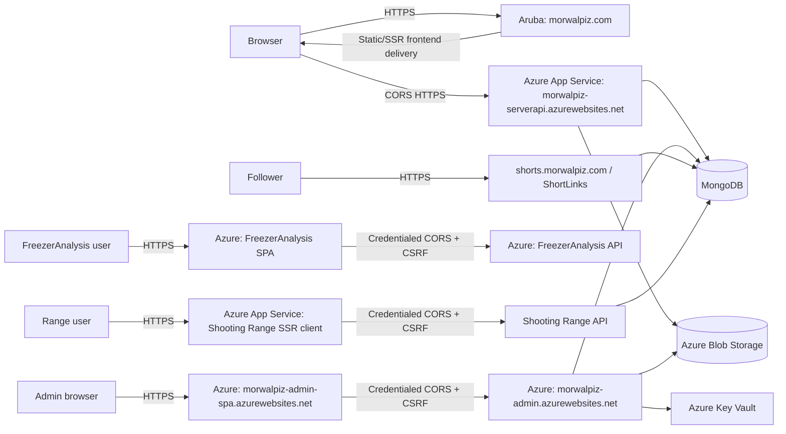

# Deployment Architecture

## Production Topology

There is no source-backed production reverse proxy from `morwalpiz.com` to ServerAPI. The browser calls Azure ServerAPI directly. Relative `/api` proxy behavior is local-development behavior only.

## Public Hosts

- `https://morwalpiz.com`: canonical public frontend on Aruba.
- `https://morwalpiz-serverapi.azurewebsites.net`: public API.
- `https://morwalpiz-admin-spa.azurewebsites.net`: BackOffice SPA.
- The BackOffice SPA image must publish `manifest.webmanifest`, `icon-192.svg`, `icon-512.svg`, and `push-sw.js` as real static files. Nginx serves the manifest and push worker with their own MIME types, 404 behavior, and revalidation policy; the worker is intentionally excluded from immutable asset caching.
- `https://morwalpiz-admin.azurewebsites.net`: BackOffice API; credentialed CORS accepts only the BackOffice SPA origin.
- FreezerAnalysis API and SPA hosts are environment-managed Azure Web Apps; the SPA receives the API origin through `VITE_FREEZER_API_BASE_URL` at image build time.
- `https://shorts.morwalpiz.com`: branded redirects.
- Shooting Range client and API hosts are environment-managed Azure App Services; the client receives the API origin through runtime `API_BASE_URL`.

The browser session between the admin SPA and BackOffice API is the Secure, HttpOnly `auth_token` cookie with `SameSite=None`; unsafe cookie requests carry the CSRF token from `/api/auth/csrf`. The SPA does not read `localStorage.authToken` or send a browser Bearer header. API-key headers remain supported for VideoImporter, InsightScanner, and other explicitly machine-authenticated callers.

Shooting Range is not publicly exposed yet but is expected to be soon. Its API and client workflows remain bound to the GitHub `production` environment. Before public exposure, the release must satisfy the authorization, CORS, CSRF, account-state, response-contract, MongoDB readiness, and booking-integrity gates in [Shooting Range Booking](../shooting-range-architecture.md).

The shop remains pre-production and on hold. Existing shop workflows or runtime artifacts do not imply approval to deploy or evolve it; deployment automation must be reviewed when the hold is eventually lifted.

Other Azure application names and custom bindings are environment-managed and must be inventoried before deployment changes.

## Container Image Staging

Deployment workflows run validation first, then build and push a commit-SHA image and a mutable `latest` tag to the configured Azure Container Registry. Buildx imports and exports a per-image `buildcache` registry reference. BackOffice API, ServerAPI, and ShortLinks also retain their existing ZIP-package deployments to Azure Web Apps in separate jobs. Their test gates are prerequisites for both jobs. ServerAPI runs its anonymous account bootstrap smoke test after the package deployment. The Azure image-deployment step remains explicitly skipped in these workflows.

For other application workflows, Azure Web App deployment remains skipped while image-only staging is prepared. Resuming deployment from those images requires verifying runtime configuration, health/readiness, and rollback. No image cleanup is performed by these workflows. The shop workflow follows image-only staging, but this does not lift its product or runtime hold.

## Local Orchestration

Aspire AppHost starts:

- ServerAPI, public client, and the on-hold shop client for local compatibility.
- BackOffice and BackOffice SPA.
- ShortLinks.
- Shooting Range API and client.

It does not provision MongoDB, Key Vault, Shooting ITA, or either WPF application. Developers supply those dependencies or use mocks/fakes.

Local development keeps the relative `/api` Vite proxy and Development credentialed CORS behavior. The production public frontend continues to call ServerAPI directly, while only the BackOffice SPA uses credentialed cross-origin calls to the BackOffice API.

## CI Baseline

Current central CI builds six active frontend applications (including their existing SSR builds), five backend hosts, both Windows clients, and Aspire AppHost. It executes the existing backend/YouTubeUtilities, seven frontend workspace suites and two Windows desktop suites, plus clean Buildx builds of all five API Dockerfiles and five active SPA images without pushing them. Deployment workflows use the shared local composite action to push images after their validation gates. Jobs fail on errors; frontend/desktop test gates reject empty collections. Matrix `fail-fast: false` collects independent failures; it does not permit failure.

FreezerAnalysis Chromium dependency installation is pinned to Ubuntu 24.04, which is supported by its Playwright version. Its Node image supplies Yarn directly. Linux test-result publishers do not create PR comments, while Windows test jobs upload TRX reports as artifacts because the publisher action requires a Linux runner.

The BackOffice and ServerAPI deployment workflows use the mixed `MorWalPizVideo.BackOffice.Tests` project with stable group filters before image publishing. BackOffice runs `BackOffice`, `Shared`, and `CrossApi`; ServerAPI runs `ServerAPI`, `Shared`, and `CrossApi`. ShortLinks has a focused gate in `MorWalPizVideo.ShortLinks.Tests`, containing only host-owned redirect/resolution/click coverage; BackOffice-owned management and Reqnroll coverage remains in the mixed project. ShootingRange uses `MorWalPizVideo.ShootingRange.Tests` for both mock and real-Mongo gates. Each active focused job rejects an empty test list. Neither workflow creates a separate ServerAPI test project. A failed validation job prevents image publication.

Required improvements for active surfaces:

- Keep shared frontend packages built in dependency order.
- Keep AppHost build verification and the active backend test projects green.
- Keep central CI's full `MorWalPizVideo.BackOffice.Tests` regression gate plus the dedicated ShortLinks and ShootingRange projects. Keep BackOffice and ServerAPI image publication gated by their owner-specific mixed-project filters plus `Shared`/`CrossApi` coverage, and retain the independent `MorWalPizVideo.YouTubeUtilities.Tests` gate; path filters include `MorWalPizVideo.YouTubeUtilities/**` so shared YouTube changes cannot publish without those tests passing.
- Require focused Shooting Range API authorization/integrity tests and non-empty client tests before image publication.
- Keep clean PR-time Docker builds for every active SPA image and the existing API Dockerfiles.
- Add secret scanning, dependency/security review, and documentation link validation.

### Delivery And Test Matrix

| Owner/surface | Central gate | Delivery gate | Local evidence 2026-10-01 |
|---|---|---|---|
| BackOffice, ServerAPI, ShortLinks, Range | .NET 10 Release builds; full `BackOffice.Tests`, `ShortLinks.Tests`, and `ShootingRange.Tests` regression | BackOffice: `BackOffice|Shared|CrossApi`; ServerAPI: `ServerAPI|Shared|CrossApi`; ShortLinks host tests before image publication; Range dedicated mock and disposable real Mongo gates before image publication | Split-project validation is tracked with this phase; the real-Mongo gate remains environment-dependent |
| YouTubeUtilities | Existing xUnit suite | Both publishing APIs retain tests and dependency path filters | PASS: 6 passed, 0 failed, 0 skipped |
| AppHost | Existing .NET 10 build | Local orchestration, not a production deployable | Not rerun in this slice |
| Shared models/services/layout | `yarn --cwd frontend build:shared` in dependency order | Required before active frontend checks | PASS |
| Shared services | `yarn --cwd frontend workspace @morwalpizvideo/services test --passWithNoTests=false` | Admin/Ask/public-video workflows also execute this suite | PASS: 2 files, 18 tests; config collects `src/**/*.test.ts`, including transport tests |
| BackOffice SPA | `yarn --cwd frontend workspace back-office-spa test --passWithNoTests=false`; checked `build` | Test job and checked build required via `needs: test` before image/publish | Tests PASS: 63 files, 290 tests; full typecheck remains a failed gate, not replaced by `build-uncheck` |
| Ask | `yarn --cwd frontend workspace ask.client test --passWithNoTests=false`; `build:all` | Tests/shared transport/checked client+SSR build before Azure login | FAIL: 1 file, 2 passed/2 failed; existing SSR error-propagation failures |
| Public video | `yarn --cwd frontend workspace morwalpizvideo.client test --passWithNoTests=false`; `build:all` | Tests/shared transport/checked client+SSR build before Azure login | PASS: 1 file, 4 tests; legacy API-key lint gate remains failed separately |
| Shooting ITA | `yarn --cwd frontend workspace shooting-ita-frontend test --passWithNoTests=false`; `build:all` | No new deployment introduced | PASS: 12 files, 32 tests |
| Range client | `yarn --cwd frontend workspace shooting-range.client test --passWithNoTests=false`; `build:all` | Existing nonempty tests and checked client/SSR build before image push | PASS: 4 files, 26 tests; browser release evidence still BLOCKED |
| Shoot Recorder | `yarn --cwd frontend workspace shoot-recorder test --passWithNoTests=false`; checked `build` | No new deployment introduced | PASS: 6 files, 16 tests |
| InsightScanner.Tests | Windows only, xUnit 2/VSTest, Release/AnyCPU; TRX executed count must be positive | No desktop deployment introduced | PASS: 4 passed, 0 failed, 0 skipped |
| VideoImporter.Tests | Windows only, xUnit 2/VSTest, Release/AnyCPU; TRX executed count must be positive | No desktop deployment introduced | PASS: 9 passed, 0 failed, 0 skipped |
| API Dockerfiles | Shared Buildx composite action, clean build, push disabled | Five API Dockerfiles preserve transitive manifests and use BuildKit cache mounts where applicable | Clean image build NOT RUN locally: Docker daemon unavailable |
| Active SPA images | Shared Buildx composite action builds BackOffice, Ask, public video, Shooting Range, and FreezerAnalysis SPA images without pushing | SPA deployment workflows call the same action to build and push | Clean image build NOT RUN locally: Docker daemon unavailable |
| Shop and standalone utilities | No test expansion or new gate | Shop image is staged only; Azure deployment remains skipped and the product hold remains | NOT RUN; historical shop Sass failure is not fixed or bypassed |

The frontend counts above are fresh local Windows runner results, not GitHub/Linux results or browser proof. The .NET suites were rerun locally with `dotnet test <project>/<project>.csproj --configuration Release --no-restore --verbosity minimal`; the Windows test projects also passed under their actual VSTest runners. Local SDK is `10.0.400-preview.0.26322.102`; CI selects `10.0.x`. CI restores first and uses `--no-restore`. The green local .NET results do not satisfy real-Mongo, browser, container, or cloud-runner gates. See [transport isolation](transport-isolation.md) and [Windows applications](windows-apps.md) for other build/typecheck/lint evidence. Deployment workflow path filters include workspace manifests/lockfile and Dockerfiles; API paths include transitive YouTubeUtilities dependencies where required.

Additional fresh checks: `yarn --cwd frontend/back-office-spa tsc -b --pretty false` FAILS with the same eight unrelated Toast/product/sponsor errors. `yarn --cwd frontend/morwalpizvideo.client eslint src/services/apiKeys.ts` FAILS with seven existing `no-explicit-any` errors. No errors were suppressed or fixed outside scope. Desktop suites now pass with 4 and 9 executed tests. Parsed YAML validates changed workflow paths, runners and test/build ordering before cloud steps; no GitHub jobs were executed locally. The remaining frontend failures and browser/container/cloud gates mean this is not an all-green release certification. Lint remains a required release-review check even where a legacy workflow does not automate it.

## Container Baseline

API Dockerfiles use SDK/runtime .NET 10, copy transitive project manifests before restore, and use BuildKit NuGet cache mounts. FreezerAnalysis additionally uses a BuildKit Yarn cache mount while building its bundled SPA. CI builds all five API Dockerfiles and active SPA images with Buildx and does not push test images. All deployment workflows use the same local composite action with per-image registry cache import/export; Azure Web App deployment steps remain disabled during this migration stage. Clean image builds still require GitHub runner execution; the local Docker daemon is unavailable. Credential context/publish exclusions do not invalidate historical artifacts; operator review remains required.

Frontend containers use each application's established runtime/build-time configuration. The shop client's existing runtime injection is retained but receives no active evolution while the hold applies.

The public MorWalPizVideo client container uses Node 22 Alpine, Buildx, and the existing Azure Container Registry BuildKit cache reference. Its Dockerfile uses builder-local locked Yarn/npm cache mounts and dependency-ordered shared-package layers; the deployment workflow retains the SHA/latest image tags, ACR cache import/export, and deployment by immutable SHA. The ACR cache provides cross-run BuildKit layer reuse; the builder-local package mounts are not treated as a cross-run cache backend. The workflow uses `docker/build-push-action@v6`. ServerAPI Docker caching remains on hold and is not implied by this client path.

## Release Order

For cross-cutting changes:

1. Deploy backward-compatible Models/Domain/Contracts behavior.
2. Apply or verify Mongo indexes and production configuration separately; deployment workflows do not perform these operations.
3. Deploy the Shooting Range API and verify `/health` and `/health/ready`.
4. Before public exposure, verify deny-by-default authorization, the configured client origin, CSRF/login/session restoration, manually inserted administrator access, safe DTOs, and booking invariants.
5. Deploy the Shooting Range client with its immutable image SHA and verify runtime `API_BASE_URL` against the API.
6. Deploy other active frontend and desktop consumers.
7. Observe legacy route/data usage.
8. Remove compatibility paths only after a defined zero-use window.

## Health And Rollback

- Liveness checks process responsiveness only.
- Readiness checks critical stores required by that host.
- Optional external-provider failures are reported without necessarily failing liveness.
- Rollback artifacts and configuration are retained for every release.
- Shooting Range container images and API releases are addressed by immutable commit SHA; a previous SHA can be redeployed manually.
- Database changes are additive until rollback risk has passed.
- Blob migrations copy and checksum before switching references; old locations remain read-only during verification.

## Blob Deployment Policy

Configure `BlobStorage:Endpoint` to the Blob service HTTPS endpoint and keep `PreferManagedIdentity=true` in production. `DefaultAzureCredential` is used by the singleton service client. `BlobStorage:ConnectionString` remains an environment-managed local-development and rollback fallback; never store it in source or evidence.

For social asset SAS, configure the BackOffice managed identity with `Storage Blob Data Contributor` on the upload scope and `Storage Blob Delegator` at the storage-account scope. Also configure `BlobStorage:StorageAccountName`, `BlobStorage:SocialAssetContainerName`, and the existing SAS TTL settings. Managed identity uses User Delegation SAS and does not require `StorageAccountKey`; if the explicit Shared Key fallback is selected with `PreferManagedIdentity=false`, keep `StorageAccountKey` only in environment configuration or Key Vault and never log it.

Apply and independently verify these Azure controls before production sign-off:

- Keep match, sponsor, and page preview containers anonymously readable to preserve current direct public URLs.
- Keep originals/uploads and temporary administrative content private.
- Keep recovery private in a separate non-production account where practical, with operator-only access.
- Grant BackOffice Blob Data Contributor only on containers it writes and ServerAPI Blob Data Reader only on the match preview container it lists.
- Enable blob soft delete, container soft delete, and old-version retention for 30 days.
- Delete abandoned temporary and recovery artifacts after 7 days with lifecycle management.
- Prove restore by comparing SHA-256 before and after an authorized private-container restore.

Credential rotation is a separate administrator-owned change from destructive cleanup. Do not combine rotation, lifecycle deletion, or recovery-object cleanup in one irreversible deployment.

## Hangfire Activation

Checked-in BackOffice configuration enables `FeatureManagement:EnableHangFire=true` but leaves `ConnectionStrings:HangfireConnection` empty. Startup fails until durable SQL is supplied through protected configuration; this is not proof that deployed Hangfire is active or disabled. Deployment automation must not provision or migrate the store implicitly. Preserve existing `YouTubeSyncCron` and recurring IDs.

Before activation, operators must approve and provision the SQL store, verify admin-only `/hangfire` access, review retries and idempotency for each recurring job, prove continuity across restart, and demonstrate exported structured job telemetry with agreed thresholds and alerts. Source-level logging and local tests do not satisfy those deployment gates. Record evidence through `operations/phase5-activation-and-recovery.md`.

## Operational Unknowns

The repository does not prove deployed Azure settings, custom-domain bindings, TLS certificates, active flags, Blob access levels, or externally created Mongo indexes. Deployment runbooks must inventory these before execution. The [release evidence checklist](operations/phase5-activation-and-recovery.md#release-evidence-checklist-2026-10-01) is BLOCKED until independent artifacts and approvals exist; completing docs/CI authoring is not production approval.