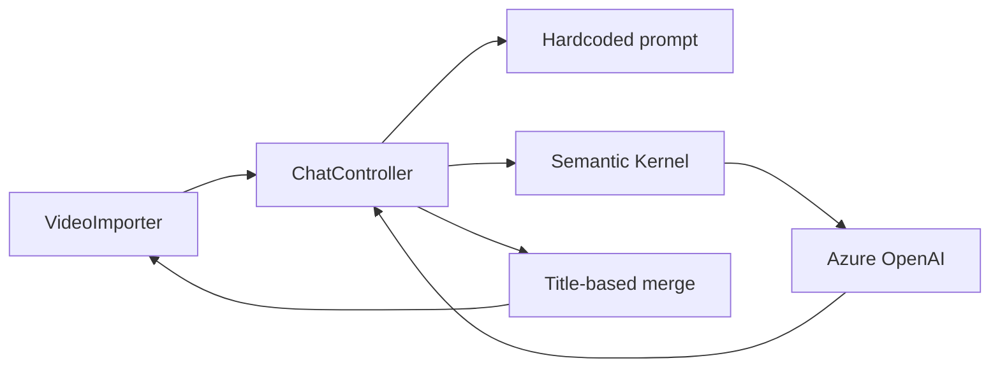
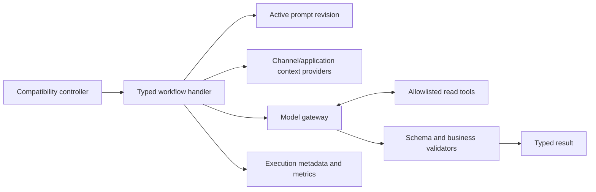

# AI prompt orchestration and improvement handoff

**Status:** Proposed architecture for review  
**Date:** 2026-11-02  
**Primary owner:** `MorWalPizVideo.BackOffice`  
**Pilot workflow:** video review, translation, and transcript analysis currently exposed by `ChatController`

## Outcome

Replace controller-owned, hardcoded AI prompts with a sustainable BackOffice-owned orchestration layer that supports runtime prompt revisions, typed multi-stage workflows, controlled evaluation and promotion, and allowlisted application tools for data already known by the selected channel or application.

Assumptions:

- The first implementation preserves the existing `api/chat`, `api/chat/translate`, and `api/chat/transcript-analysis` request and response shapes used by VideoImporter. A compatibility adapter may remain while a versioned AI workflow API is introduced later.
- The pilot covers the `ChatController` workflows. Script Studio, FAQ candidate generation, Ask moderation, and Insights adopt the shared foundation only in later, separately validated slices.
- "Automatic improvement" means automatic creation and evaluation of a candidate prompt revision. It does not mean direct mutation or automatic production promotion. Human approval, a measurable quality gate, canary activation, and rollback remain mandatory.
- Initial tools are read-only and channel-scoped. No model-initiated write, publication, arbitrary Mongo query, URL fetch, filesystem access, or command execution is in scope.
- Existing Azure OpenAI protected configuration remains the model credential source. Prompt text, examples, evaluation cases, and tool policies are data, not secrets.

Completion boundary: stop when the pilot workflows execute through the new service, prompt revisions can be managed and rolled back, deterministic fake execution works in mock mode, approved read tools are enforced, evaluation evidence can produce but not self-promote a candidate, and the legacy VideoImporter contract is proven compatible. Migration of every other AI caller is backlog requiring separate approval.

## Current Evidence

- `MorWalPizVideo.BackOffice/Controllers/ChatController.cs` injects `Kernel` directly and owns HTTP handling, chunking, prompt construction, provider calls, JSON deserialization, terminology lookup, output validation, and result joining. Four separate prompt bodies are embedded in this controller.
- Video review already has two stages: Italian metadata generation followed by translation. The second stage serializes generated metadata into `customObjectForTranslation` and joins the response to the first stage by generated title. A title is mutable model output and is not a reliable correlation key.
- Review batches are recursively split into groups of ten. Count equality is checked, but identity, duplicate input names, language coverage, individual validation failures, retries, cancellation, provider usage, and partial results are not represented explicitly.
- `ResolveChannelTerminologyAsync` obtains configured terminology through `IChannelContextResolver`; if no channel terminology resolves, it silently uses an embedded default dictionary. The terminology is interpolated as delimited JSON but the entire call still uses one assembled prompt string.
- `MorWalPizVideo.BackOffice/Program.cs` registers `IChatCompletionService` and `Kernel` only when mock mode is disabled. The mock host therefore cannot activate `ChatController`. This is recorded as TD-031 and API-04 in the architecture audit.
- `MorWalPizVideo.BackOffice/MorWalPizVideo.BackOffice.csproj` currently references Semantic Kernel 1.80.0. Exact function-selection APIs must be checked against this installed version during implementation rather than inferred from another release.
- `MorWalPizVideo.BackOffice/Services/SemanticKernelFaqCandidateAiProvider.cs` is the nearest typed-provider precedent: provider access is behind a feature interface and uses a structured response. `FaqCandidateGenerationService` adds timeout, bounded retry, persistence, and explicit failure behavior outside the provider.
- `MorWalPizVideo.BackOffice/Services/ScriptStudioService.cs` and the Script Studio repositories provide a useful but insufficient precedent. They persist one mutable global prompt with a monotonically increasing version and write metadata-only audit events with 60-day retention. They do not retain immutable revisions, workflow/stage identity, activation history, experiments, evaluation cases, canaries, or rollback pointers.
- `MorWalPizVideo.Domain/FeatureServices.cs` already exposes focused content and category queries. `ChannelContextResolver` already resolves API-key/channel binding, ownership, effective identity, and the selected `YTChannel`. Tools can project through these boundaries instead of exposing repositories to the model.
- `MorWalPiz.VideoImporter/Services/ApiService.cs` calls all three Chat routes. `VideoContextDialog.xaml.cs` submits per-video context and `MainWindow.xaml.cs` applies returned metadata by video name. Users may then edit title, description, tags, and translations in `FileDetailPage.xaml.cs`, but no execution ID or accepted/edited/rejected feedback currently returns to BackOffice.
- `frontend/back-office-spa` has an unused `VideoService.getReviewDetails` wrapper whose TypeScript `ReviewDetails` shape does not match the current BackOffice response. It is not evidence of an active browser consumer.
- ServiceDefaults supplies OpenTelemetry. Feature-specific meters and structured logs already exist elsewhere, while current Chat calls emit no workflow, revision, validity, tool, usage, cost, or latency evidence.

Current flow:

## Proposed Design

### Ownership and boundaries

BackOffice owns an AI orchestration feature because it owns the administrative workflows, Semantic Kernel registration, channel scope, API-key authentication, and existing AI integrations. Models owns Mongo entities and collection names. Domain owns repository abstractions and Mongo/mock implementations. `MorWalPiz.Contracts` owns management and feedback DTOs shared across .NET callers. The BackOffice SPA owns the operational prompt-management interface. VideoImporter remains a client and must not know prompt internals.

Introduce these BackOffice application boundaries:

- `IAiWorkflowService`: executes a named workflow with a typed request, authenticated execution context, and cancellation token.
- One handler per pilot workflow. A video-metadata handler owns chunking and the metadata/translation stages; translation and transcript handlers own their specific stage graphs.
- `IAiPromptCatalog`: resolves one immutable active revision for a workflow and stage, with optional channel override only where explicitly supported.
- `IAiModelGateway`: the only Semantic Kernel-facing adapter. It accepts role-separated messages, structured response type, allowed tool set, timeout, and execution metadata. A deterministic fake implements the same boundary.
- `IAiToolRegistry` and `IAiToolInvoker`: expose only statically registered, typed, authorized application tools. Prompt data may select from an administrator-defined subset of the static allowlist but cannot define executable code or arbitrary endpoints.
- `IAiEvaluationService`: evaluates a baseline and candidate against a frozen dataset and records deterministic, human, and optional judge-model evidence separately.
- `IAiPromptOptimizationService`: creates a draft revision from aggregate failures and selected evaluation cases. It cannot activate a revision.

The controller becomes a compatibility adapter: validate the HTTP DTO, obtain the caller/channel execution context, call the appropriate workflow, and map its typed result to the existing response.

### Prompt model

Use separate additive Mongo collections:

- `aiPromptDefinitions`: stable workflow/stage key, display metadata, scope policy, expected input/output schema identifiers, allowed tool names, and pointers to active/canary revisions.
- `aiPromptRevisions`: immutable template/messages, variable contract, parent revision, change rationale, author/source, creation time, lifecycle (`Draft`, `Approved`, `Active`, `Retired`, `Rejected`), model parameter profile, and content hash.
- `aiExecutionRecords`: correlation/execution ID, workflow/stage/revision, selected channel ID, provider deployment name, start/duration, status/error code, structured-output validity, retry count, tool names and outcomes, token usage when supplied, item counts, and expiry. Do not persist raw prompts, credentials, full tool payloads, transcripts, or generated content by default.
- `aiEvaluationCases`: consented or curated input, expected constraints or approved output, source classification, redaction status, tags, and immutable dataset version membership. Retention and deletion must be explicit because these records may contain user-supplied text.
- `aiPromptExperiments`: frozen baseline/candidate revision IDs, dataset version, scoring policy version, aggregate and per-case results, cost/latency deltas, approval state, canary allocation, activation timestamps, and rollback reason.

Definitions may change active pointers; revisions and completed experiment evidence remain immutable. Activation uses compare-and-set semantics against the expected current active revision so concurrent administrators cannot overwrite each other. Every activation and rollback writes an audit event through the existing audit infrastructure or an AI-specific metadata-only audit collection.

Prompt revisions are structured as role-separated messages and named variables, not one arbitrary interpolated string. Each definition declares the only legal variables. Publishing rejects unknown variables, missing required variables, oversized content, unregistered tools, invalid response schema identifiers, and unsafe scope combinations. User text, transcript text, generated intermediate data, and tool output are treated as untrusted data and placed in delimited user/tool messages rather than system instructions.

### Workflow execution

For video review, assign an opaque `itemId` before chunking. Include it in both structured stage outputs and join only by that ID. Preserve the external `Name` response for VideoImporter compatibility. Reject duplicate/missing/unknown IDs and duplicate language results before mapping the response. Validate title length, description length, tag count, requested languages, and per-item completeness in code; prompts describe these rules but do not enforce them authoritatively.

Required context should be loaded deterministically before the model call. Channel terminology is required and cheap, so the workflow should resolve and inject it directly rather than spending a tool round-trip. Function calling is reserved for optional information whose need depends on the request.

### Function calling policy

Initial candidate tools:

- Read the already-authorized selected channel profile and terminology projection.
- List bounded channel category/tag vocabulary through focused application services.
- Retrieve a bounded, public-safe projection of known content metadata by explicit ID when a workflow input supplies that ID.

Each tool receives the server-created execution context, never a caller/model-supplied channel or user ID. The implementation rechecks channel scope and permissions, applies limits and timeouts, projects away persistence/internal fields, and returns stable typed errors. Tool output is marked as data and cannot alter system policy. Tool calls and outcome codes are audited, but sensitive arguments and returned content are not logged.

The model cannot construct Mongo filters, select a repository, enumerate unrestricted collections, fetch arbitrary URLs, or call an unregistered function. Initial workflows permit read-only tools only. Any future write tool requires a separate design with explicit user confirmation, idempotency, authorization, audit, replay protection, and a non-AI validation path.

### Improvement loop

1. Record hard signals for every execution: schema validity, item/language completeness, deterministic SEO rule results, retries, latency, token usage, tool errors, and provider failures.
2. Return an execution ID to clients additively. VideoImporter can later report `Accepted`, `Edited`, or `Rejected`, plus only the changed fields needed to form a consented evaluation case. Upload/publish success must not be treated automatically as approval of every generated field.
3. Curate and version evaluation datasets. Separate training-like examples from a holdout set; prevent a candidate-generation process from seeing holdout expected outputs.
4. Allow the optimizer to create a draft child revision with a rationale based on selected examples and aggregate failures. The optimizer cannot modify the active revision or tool registry.
5. Run baseline and candidate against the same frozen cases. Score deterministic contract/SEO rules first, human acceptance/edit evidence second, and optional blind pairwise judge-model evidence last. A candidate cannot pass on self-judging alone.
6. Require configured non-regression thresholds for correctness, channel terminology, safety, latency, and token/cost budget. Store the full scoring policy version with the experiment.
7. Require an authorized administrator to approve activation. Start with a small deterministic canary allocation, monitor quality/error/cost signals, then promote or roll back by pointer change. Never rewrite or delete the previous active revision during promotion.

Optimization should initially run on demand. A Hangfire candidate-generation job is appropriate only after enough reviewed cases exist, durable Hangfire storage is active, and idempotency, quotas, retry behavior, and alerting have been proven. Scheduling before those conditions would automate noise rather than improvement.

### Administrative UI

Add a dedicated AI workflow administration route rather than expanding Script Studio's content-authoring page. It is an **Operate** surface and a focused refinement of the existing BackOffice, not a visual redesign.

The route should support definition/stage selection, active revision inspection, draft editing with variable/tool validation, immutable revision history and diff, evaluation run results, approval, canary activation, rollback, and metadata-only execution health. Raw credentials and unrestricted execution content never appear. Destructive or production-changing actions use the existing confirmation, pending, toast, and accessible error patterns.

Implementation should apply the installed Impeccable `shape` workflow to this route before UI work, preserving React Bootstrap, route loaders/actions, shared services/models, current navigation, and permission conventions. Minimum visual evidence is desktop and narrow/mobile screenshots of list, revision editor, evaluation results, validation errors, and activation confirmation. Keyboard order, focus restoration, labels, contrast, overflow, reduced motion, loading, empty, forbidden, and provider-unavailable states must be checked.

## Impacted Projects

- **MorWalPizVideo.Models:** new AI prompt, revision, execution, evaluation, experiment, and audit entities; collection and permission constants.
- **MorWalPizVideo.Domain:** repository interfaces plus Mongo/mock implementations; focused bounded query reuse for tools.
- **MorWalPiz.Contracts:** prompt-management, experiment, feedback, and additive execution-metadata DTOs shared by BackOffice and .NET clients.
- **MorWalPizVideo.BackOffice:** orchestration services, Semantic Kernel adapter/fake, tool registry, controllers, authorization, DI, metrics, validation, optional jobs, and protected configuration.
- **MorWalPizVideo.BackOffice.Tests:** unit, HTTP behavior, authorization, Mongo compatibility, fake provider, tool isolation, evaluation, and legacy contract coverage.
- **frontend/fe-packages/models:** TypeScript management and evaluation contracts.
- **frontend/fe-packages/services:** centralized BackOffice AI administration and feedback endpoints.
- **frontend/back-office-spa:** AI workflow administration route, menu/permission integration, revision/evaluation UI, and component tests.
- **MorWalPiz.VideoImporter:** additive execution-ID retention and explicit feedback submission after the server foundation is stable; existing generation behavior remains compatible in the first deployment.
- **MorWalPiz.VideoImporter.Tests:** API contract, feedback payload, and accepted/edited/rejected behavior once desktop feedback is enabled.
- **MorWalPizVideo.AppHost:** verify-only unless a new configuration reference is required; no new deployable service is proposed.
- **MorWalPizVideo.ServerAPI, ShortLinks, Shooting Range, FreezerAnalysis, public frontends, shop, Shooting ITA, TelePrompter, and stage-designer:** not impacted by the pilot. Existing ServerAPI Ask moderation remains independent.

## Impacted Files

### Modify

- `MorWalPizVideo.BackOffice/Controllers/ChatController.cs`: reduce to compatibility mapping and delegate to typed workflows; remove prompt/provider ownership after cutover.
- `MorWalPizVideo.BackOffice/Program.cs`: register catalog, repositories, workflow handlers, model gateway or fake, tools, validators, and feature flag branches in both production and mock mode.
- `MorWalPizVideo.BackOffice/MorWalPizVideo.BackOffice.csproj`: change only if the installed Semantic Kernel package must be updated after compatibility review; no update is assumed by this plan.
- `MorWalPizVideo.BackOffice/appsettings.json`: add non-secret orchestration limits, retention, disabled-by-default rollout/canary policy, and timeouts.
- `MorWalPizVideo.Models/Constraints/DbCollections.cs`: add centralized collection names.
- `MorWalPizVideo.Models/Constraints/AuthorizationKeys.cs`: add separate view, edit, evaluate, and activate permissions; prompt editing must not imply production activation.
- `MorWalPizVideo.Domain/Security/AuthorizationPermissionExpander.cs`: add only reviewed one-way implications.
- `MorWalPizVideo.Domain/Interfaces/IRepository.cs`, `Repository.cs`, and `MockRepository.cs`: register focused prompt/evaluation repositories and atomic activation behavior.
- The owning mock scenario under `MorWalPizVideo.Domain/Scenarios/`: seed deterministic prompt definitions, revisions, evaluation cases, and fake outputs.
- `MorWalPiz.Contracts/DTOs/ReviewRequest.cs`, `Review.cs`, and `ReviewDetails.cs`: preserve existing wire fields; add execution metadata only if it is proven non-breaking, otherwise introduce a versioned response contract.
- `frontend/back-office-spa/src/authorization/permissions.ts`, `router/routes/lazy-index.ts`, and `layouts/adminMenu.ts`: register the new protected operational surface.
- `MorWalPiz.VideoImporter/Services/ApiService.cs`, `Views/VideoContextDialog.xaml.cs`, `MainWindow.xaml.cs`, `Views/FileDetailPage.xaml.cs`, and the owning local model/persistence path: retain execution identity and submit explicit feedback in the later feedback slice.
- `docs/architecture/backend.md`, `api-design.md`, `security.md`, `development.md`, `technical-debt.md`, and `future-improvements.md`: record current implementation, fake behavior, authorization, data retention, tool policy, and close TD-031 only after mock HTTP proof.
- `MorWalPizVideo.BackOffice/README.md`: document operational behavior and non-secret settings after implementation.

### Add

- `MorWalPizVideo.Models/Models/AiOrchestration.cs`: persisted entities and enums, or a feature-equivalent folder if implementation conventions favor one type per file.
- `MorWalPizVideo.BackOffice/Services/Ai/`: prompt catalog, workflow orchestrator/handlers, renderer, validators, Semantic Kernel gateway, deterministic fake, evaluation, optimization, and tool registry/invokers.
- `MorWalPizVideo.BackOffice/Controllers/AiPromptsController.cs` and an experiment/evaluation controller or equivalent responsibility-focused controllers.
- `MorWalPiz.Contracts/DTOs/AiOrchestrationDtos.cs`: management, experiment, execution metadata, and feedback contracts; split by responsibility if the file would become broad.
- `frontend/fe-packages/models/src/aiOrchestration.ts` and `frontend/fe-packages/services/src/aiOrchestrationService.ts`.
- `frontend/back-office-spa/src/routes/aiWorkflows/`: route-local list, revision, evaluation, and activation modules plus focused tests.
- Focused test files under `MorWalPizVideo.BackOffice.Tests/Features/` for workflow execution, prompt lifecycle, tool authorization, mock activation, evaluation, and compatibility.
- An ADR under `docs/architecture/adr/` for prompt lifecycle, AI tool trust boundary, controlled promotion, data retention, and rollback.

### Generated/Migration

- No generated source should be edited.
- Add an idempotent, operator-invoked prompt bootstrap/backfill operation that creates the initial immutable revisions from the reviewed current prompt behavior and records their content hashes. Do not silently rewrite existing Script Studio data.
- Add Mongo index manifest entries for unique definition keys, unique revision identity/hash as selected by implementation, execution expiry, evaluation lookup, and experiment status. Applying indexes remains an operator-approved operation through the repository's existing Mongo index governance.

### Documentation

- This handoff is the implementation source of truth until the ADR and architecture guides are updated with actual behavior.
- After implementation, update this file with the real files changed, migrations executed, validation evidence, rollout state, and residual risks.

### Verify Only

- `MorWalPizVideo.AppHost/Program.cs` and deployment workflows: verify configuration propagation and existing BackOffice gates; no topology change is expected.
- `MorWalPizVideo.ServerAPI/Services/AskModerationProvider.cs`, `MorWalPizVideo.BackOffice/Services/SemanticKernelFaqCandidateAiProvider.cs`, `InsightAgentService.cs`, and `ScriptStudioService.cs`: verify later migration compatibility but do not refactor them in the pilot.
- `frontend/back-office-spa/src/services/videoService.ts` and `frontend/fe-packages/models/src/video/types.ts`: confirm the unused mismatched wrapper before removal or correction; do not broaden the pilot merely to clean it up.

## Impact Matrix

| Area | Impact |
|---|---|
| Backend/API | Existing Chat routes become adapters over typed workflows. New management/evaluation endpoints are explicit DTO APIs and should use versioned routes and Problem Details. |
| Frontend/UI | New BackOffice operational route for revisions, evaluations, activation, and rollback. Existing Script Studio authoring remains separate. |
| Database/Data | Additive Mongo collections and indexes. No existing document rewrite. Evaluation content requires consent/redaction, retention, and deletion policy. |
| Contracts/Models | New persisted entities and admin DTOs. Existing VideoImporter payloads remain compatible; execution identity is additive or versioned. |
| Authentication/Authorization | Existing Chat API-key boundary remains. Management uses distinct least-privilege permissions. Tool execution inherits effective identity and selected channel; no model-supplied scope. |
| Validation | Template/schema/tool validation at publish time; request, ID, language, SEO, and structured-output validation at execution time; activation thresholds at experiment time. |
| Cache | Prompt active pointers may use a short local cache only with explicit invalidation on activation/rollback. Correctness must not depend on stale cache. No ServerAPI output-cache impact. |
| Configuration/Secrets | Reuse protected `AzureConfig:OpenAi`. Add only non-secret limits, feature flag, retention, timeout, and canary policy. Never persist or expose credentials in prompt records. |
| Logging/Telemetry | Structured workflow/stage/revision, duration, usage, status, retry, schema validity, tool outcome, and canary metrics. Do not log prompt/input/output/tool content or credentials. |
| Background Jobs | Not required for initial on-demand evaluation. Optional optimizer scheduling is deferred until durable Hangfire, idempotency, quotas, and useful reviewed data are proven. |
| Deployment/Operations | Dark deploy repositories/UI first, idempotently seed and index, evaluate baseline, then enable pilot behind a flag and canary. No new service or host. |
| Backward Compatibility | Preserve Chat wire behavior and legacy fallback during rollout. Stable internal `itemId` fixes stage correlation without changing external `Name`. Other AI features remain untouched. |

## Reuse Opportunities

- Reuse `IChannelContextResolver` and `HttpContext.GetChannelContext()` for authoritative channel scope and API-key binding.
- Reuse `IContentService` and focused repository queries to build bounded projections; do not hand the model generic repositories.
- Reuse the typed-provider separation demonstrated by `SemanticKernelFaqCandidateAiProvider` and the timeout/retry boundary in `FaqCandidateGenerationService`.
- Reuse Script Studio's permission, metadata-only audit, retention job, route, shared-service, and React operational patterns while keeping its single global prompt record separate.
- Reuse Models -> Domain/Contracts -> BackOffice dependency direction, Mongo/mock repository pairs, scenario fixtures, `BaseEntity`, and centralized collection constants.
- Reuse ServiceDefaults/OpenTelemetry and existing feature meter patterns.
- Reuse BackOffice route loaders/actions, `PageHeader`, confirmation modal, toast, generic error, and permission checks for the management UI.
- Reuse the existing VideoImporter `IHttpClientFactory` client and API-key/channel headers.

## Risks

| Rank | Risk, cause, and affected surface | Mitigation | Verification signal |
|---|---|---|---|
| High | A self-improving loop promotes regressions because model output is treated as ground truth. | Candidate-only automation, frozen holdout, deterministic and human evidence, explicit approval, canary, immutable rollback. | No service path can move Draft to Active without activation permission and passing experiment policy. |
| High | Tool calling bypasses authorization or leaks cross-channel/private data. | Static allowlist, server-created context, per-tool authorization, bounded projections, no arbitrary query/URL/write tools. | Cross-channel, injected-channel, over-limit, and unauthorized tool tests fail closed and disclose no data. |
| High | Prompt injection in transcript, context, stored data, or tool output changes policy or invokes unsafe tools. | Role separation, untrusted-data delimiters, tool allowlist, argument validation, no executable prompt-defined tools. | Adversarial cases cannot select unapproved tools, change scope, or escape the response schema. |
| High | Legacy VideoImporter behavior breaks during the orchestration cutover. | Compatibility adapter, contract tests, stable response mapping, feature flag, dual-path rollback window. | Existing desktop fixture deserializes and applies a complete multi-video/multi-language response. |
| Medium | Dynamic prompts create configuration drift with no reproducible production state. | Immutable revisions, content hashes, activation audit, exported metadata, experiment linkage, no in-place edits. | Every execution resolves to one revision ID/hash and every active pointer change is attributable. |
| Medium | Evaluation records retain transcripts or generated content longer than intended. | Data minimization, explicit opt-in/curation, redaction, expiry indexes, delete workflow, no raw content in execution telemetry. | Retention tests and repository audit show expired content removed while aggregate metadata remains. |
| Medium | Costs and latency grow through extra stages, tools, retries, and candidate evaluations. | Required context preloading, bounded tools, budgets, usage metrics, batch limits, evaluation quotas, stop conditions. | Candidate cannot pass when configured latency/token deltas exceed policy; dashboards expose deltas by revision. |
| Medium | Active prompt cache serves stale revisions after rollback. | Versioned cache keys or direct pointer validation, explicit invalidation, short bounded TTL, revision ID in every execution record. | Rollback test proves the next execution resolves to the restored revision within the declared bound. |
| Medium | Provider/function-calling behavior changes across Semantic Kernel versions. | Pin package, isolate provider adapter, verify installed-version APIs, contract-test fake and provider mapping. | Package update changes only the gateway and passes the same workflow/tool contract suite. |
| Low | Prompt administration UI is overloaded and encourages unsafe activation. | Separate edit/evaluate/activate permissions, clear lifecycle, diff, confirmation, quality/cost summary, disabled invalid states. | Keyboard/component tests and visual evidence cover forbidden, invalid, pending, and rollback states. |

## Technical Debt

- **TD-031 / API-04, blocking:** mock mode lacks the Chat AI dependency. Address now by moving external access behind `IAiModelGateway` and registering a deterministic fake. Close only after all Chat actions execute through the mock HTTP host.
- **Broad `ChatController`, blocking maintainability:** controller owns orchestration and provider details. Address now for the pilot only.
- **Generated-title correlation, blocking correctness:** replace internally with stable item IDs now.
- **Inconsistent AI patterns across Chat, FAQ, Insights, Ask, and Script Studio, non-blocking for pilot:** isolate the new foundation and migrate one feature at a time after evidence; do not refactor every caller in the first slice.
- **Script Studio mutable global prompt, non-blocking:** retain compatibility. A future migration may import it as a dedicated workflow revision after Script Studio behavior and permissions are mapped.
- **Unused/mismatched BackOffice SPA review wrapper, non-blocking:** verify usage and remove or correct in a separate cleanup.
- **VideoImporter code-behind and swallowed review API failures, relevant but not a prerequisite for server foundation:** isolate feedback additions and preserve the existing WPF architecture; full MVVM conversion is out of scope.
- **No current AI quality baseline, delivery constraint:** the first release can prove reliability and collect feedback, but cannot claim prompt improvement until a representative reviewed dataset and acceptance thresholds exist.

## Implementation Roadmap

1. **Freeze the pilot contract and baseline.** Capture representative current Chat requests/results, deterministic validation rules, desktop deserialization behavior, current failure modes, and expected terminology behavior. Decide whether execution metadata is additive or requires a versioned response. Gate: compatibility tests describe all three routes before internals move.
2. **Add the AI persistence and repository foundation.** Add entities, centralized collections, focused repository interfaces, Mongo/mock implementations, atomic active-pointer update, expiry queries, and deterministic scenario data. Gate: repository tests prove immutable revisions, compare-and-set activation, rollback, and expiry behavior.
3. **Build prompt catalog and publication validation.** Implement structured role messages, declared variables, schema identifiers, registered tool names, revision lifecycle, content hash, and active/canary resolution. Add idempotent initial prompt bootstrap from the reviewed baseline. Gate: invalid variables, tools, schemas, states, and concurrent activation are rejected.
4. **Introduce the provider-neutral model gateway.** Encapsulate Semantic Kernel 1.80 integration, structured response mapping, tool selection, timeout, cancellation, usage extraction, and stable errors. Register a deterministic fake in mock mode. Gate: fake contract tests cover success, malformed schema, timeout, transient failure, cancellation, and tool requests without network access.
5. **Move Chat behavior into typed workflow handlers.** Implement stable `itemId`, iterative bounded chunking, two-stage metadata/translation execution, deterministic context preloading, code-level result validation, and legacy response mapping. Keep the old route/controller surface as an adapter behind a rollout flag. Gate: mock-host HTTP tests execute every action and preserve VideoImporter-compatible outputs; TD-031 can then close.
6. **Add the initial read-tool registry.** Implement only approved channel/context, vocabulary, and explicit-ID metadata projections through existing authorization/application services. Bind allowed tool subsets to prompt definitions. Gate: authorization, channel isolation, argument bounds, prompt injection, timeout, unavailable data, and unregistered tool tests pass.
7. **Add execution telemetry and retention.** Record metadata-only execution records, activity/metrics, usage when available, schema/tool/error outcomes, revision IDs, and expiry. Do not log content. Gate: success/failure/canary traces are correlatable without exposing request, prompt, response, credentials, or tool payloads.
8. **Expose management and evaluation APIs.** Add explicit DTOs, Problem Details, pagination, lifecycle commands, separate permissions, audit, baseline/candidate evaluation, and manual activation/rollback. Gate: permission matrix proves viewers, editors, evaluators, and activators cannot exceed their roles; API-key Chat callers cannot administer prompts.
9. **Build the BackOffice administration route.** Apply Impeccable `shape`, then implement loader/action-based definition, revision, diff, evaluation, activation, rollback, empty/error, and provider-unavailable states using existing components and shared clients. Gate: focused Vitest/Testing Library coverage, checked build, responsive screenshots, keyboard/focus/contrast/overflow checks.
10. **Collect explicit feedback.** Return execution identity, retain it with generated desktop metadata, and submit accepted/edited/rejected outcomes from the actual review/edit lifecycle. Store only approved/redacted fields needed for evaluation. Gate: feedback cannot target another channel/execution, duplicate submission is idempotent, and edits are distinguishable from acceptance.
11. **Enable controlled candidate optimization.** Create draft revisions on demand from selected feedback/evaluation cases, freeze dataset/scoring policy, compare baseline/candidate, and enforce quality/cost/latency thresholds. Keep activation manual. Gate: holdout isolation, reproducible scoring, failed-threshold rejection, and previous-revision rollback are proven.
12. **Roll out in stages and document actual behavior.** Deploy dark, seed and index, run baseline evaluation, enable internal/admin canary, expand only with stable signals, then retire the legacy hardcoded path after the compatibility window. Update the ADR, architecture guides, technical debt, operational settings, and this handoff. Gate: rollback rehearsal and monitoring ownership are recorded before full activation.

Independent post-validation review is warranted because this change adds a model-to-application trust boundary, new persisted operational state, authorization-sensitive tools, and a production prompt promotion mechanism. The user should select `MorWalPiz Code Reviewer` after implementation and focused validation, before broad activation.

## Testing Strategy

- **Unit, BackOffice.Tests:** template variable validation, role separation, stable item IDs, duplicate/missing IDs, language completeness, title/description/tag rules, revision state machine, content hashes, scoring thresholds, canary selection, rollback, redaction, and retention calculations.
- **Repository/Mongo compatibility, BackOffice.Tests:** additive deserialization, unique keys/index manifest, immutable revision behavior, atomic expected-revision activation, concurrent administrators, execution expiry, dataset/experiment lookup, and mock/Mongo behavioral parity.
- **Provider contract, BackOffice.Tests:** deterministic fake plus adapter mapping for structured success, malformed/empty output, provider error, timeout, retry, cancellation, usage metadata, tool call, excessive tool loop, and unavailable tool.
- **HTTP behavior, BackOffice.Tests:** all existing Chat routes under API-key authentication and selected channel; zero/one/ten/more-than-ten videos; duplicate names; multiple contexts; unsupported/duplicate languages; partial model output; terminology present/empty; explicit error contract; no external network in mock mode.
- **Tool security, BackOffice.Tests:** missing scope, API-key/channel mismatch, inaccessible channel, model-supplied channel/user arguments, cross-channel ID, oversized result request, unregistered tool, arbitrary query/URL attempt, prompt injection in every untrusted source, and sensitive-field projection.
- **Prompt management authorization, BackOffice.Tests:** list/view/edit/evaluate/activate separation, impersonation restrictions if applicable, CSRF for cookie-backed mutations, API-key denial, stale activation conflict, audit creation, and safe Problem Details.
- **Evaluation, BackOffice.Tests:** frozen dataset identity, baseline/candidate use the same cases, deterministic scorer precedence, holdout not supplied to optimizer, quality/cost/latency non-regression, failed candidate rejection, canary and rollback evidence.
- **Desktop, VideoImporter.Tests:** current payload deserialization and application, execution-ID retention, accepted/edited/rejected feedback, duplicate feedback idempotency, offline/error behavior, and no prompt-management knowledge in the client.
- **Frontend, BackOffice SPA:** loaders/actions, permission gating, revision validation, diff, pending/empty/error/forbidden states, evaluation display, activation confirmation, stale conflict, rollback, keyboard/focus behavior, and no sensitive content rendering.
- **Contract:** preserve the unversioned Chat response during the compatibility window; add serialized fixture tests on both BackOffice and VideoImporter sides. New management APIs use explicit DTOs and versioned routes.
- **End to end:** selected channel -> VideoImporter generation -> human edit/accept feedback -> curated evaluation -> candidate comparison -> administrator canary -> execution on candidate -> rollback to baseline. Real Azure provider verification is a bounded operational gate and must not replace fake-based CI.

## Migration And Rollback

### MongoDB

Use an additive tolerant-read transition. New collections do not require rewriting existing content, channels, Script Studio records, or VideoImporter SQLite data. Seed initial prompt definitions/revisions idempotently with deterministic keys and content hashes through an operator-invoked operation. Add indexes through the existing reviewed Mongo index process, not automatic startup mutation. Evaluation/execution expiry indexes delete only records whose retention deadline is explicit.

### API contracts

Keep existing Chat routes and response mapping while the new path is feature-controlled. Add execution metadata only when both JSON compatibility and desktop behavior are proven; otherwise return it from a versioned route and migrate VideoImporter deliberately. Prompt management starts versioned and has no legacy contract.

### Authentication and tools

No authentication migration is required. Existing API-key generation calls remain, while management is cookie/JWT BackOffice administration with new permissions. Tool-enabled execution requires a resolved channel; during compatibility rollout, requests without valid scope either use the legacy no-tool behavior or receive the existing explicit channel-context contract after consumer evidence supports enforcement. Never silently grant global tool scope.

### Cache

Prompt revisions are immutable. Active-pointer caching is optional and bounded. Activation and rollback invalidate the definition pointer; execution records store the resolved revision. Rollback changes only the pointer and feature/canary state, not revision documents.

### Configuration and deployment order

1. Deploy additive models, repositories, fake provider, management APIs/UI, and disabled orchestration path.
2. Apply reviewed indexes and idempotently seed baseline revisions.
3. Run baseline and mock compatibility gates; verify protected provider configuration without exposing values.
4. Enable the new path for internal/admin canary traffic, then a bounded percentage of pilot calls.
5. Expand only while validity, feedback, tool, latency, usage, and error signals remain within policy.
6. Remove hardcoded fallback only after all known consumers are migrated and the rollback window is formally closed.

### Rollback

First rollback is an atomic active-pointer return to the previous revision. Second rollback disables the candidate/canary. During the compatibility window, final rollback disables the new orchestration flag and returns Chat to the legacy implementation. Additive collections may remain; do not delete evaluation or activation evidence during an incident. If a tool leaks or crosses scope, disable that tool in the static registry/configuration and the affected prompt definition, revoke exposed access as applicable, preserve redacted audit evidence, and investigate before reactivation.

Rollback cannot recover content already sent to the external provider or leaked by an unsafe tool. This is why data minimization, provider policy, static tools, and pre-activation security tests are release gates.

## Open Questions

1. Should base prompt definitions be global with optional channel overlays, or should every channel own independent revisions? Recommendation: global base revisions plus tightly constrained channel context/terminology initially; add channel-specific overrides only after a demonstrated need because they multiply evaluation and rollback states.
2. Which VideoImporter action is authoritative feedback: applying generated text, saving edits, scheduling, upload success, or an explicit rating? Recommendation: explicit accepted/edited/rejected at review/save time; upload success is an operational outcome, not sufficient quality evidence.
3. Which read tools are required in the first pilot beyond selected-channel terminology and bounded category/tag vocabulary? Every proposed tool needs a concrete workflow question and an owning service before implementation.
4. May curated evaluation cases retain full transcripts and generated descriptions, and for how long? This privacy/retention decision must be approved before content-bearing evaluation records are enabled.
5. What minimum reviewed dataset size and quality/cost/latency thresholds authorize a canary? Until agreed, candidate generation may exist but production activation must remain blocked.
6. Is a separate Azure OpenAI deployment required for optimization/judging to isolate quota and reduce correlated self-evaluation? This affects configuration and cost, not the core ownership design.
7. Should management activation require `backoffice.manageall` in addition to a dedicated `ai.prompts.activate` permission? Recommendation: dedicated permission with explicit audit, optionally limited to global administrators during the pilot.