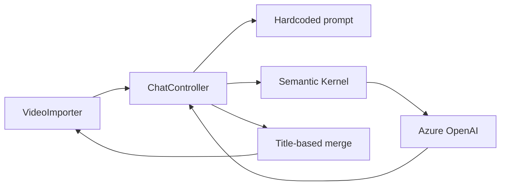
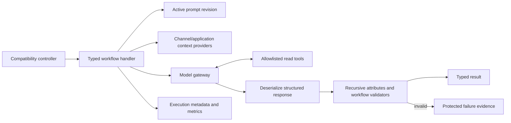
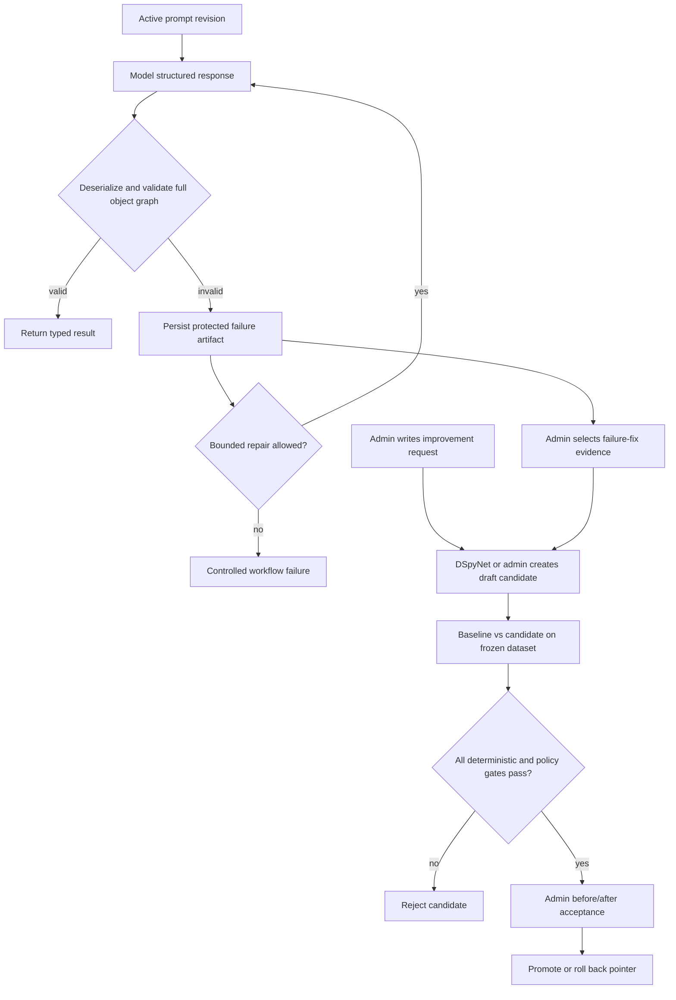

# AI prompt orchestration and improvement handoff

**Status:** Proposed architecture for review  
**Date:** 2026-11-02  
**Primary owner:** `MorWalPizVideo.BackOffice`  
**Pilot workflow:** video review, translation, and transcript analysis currently exposed by `ChatController`

## Outcome

Replace controller-owned, hardcoded AI prompts with a sustainable BackOffice-owned orchestration layer that supports runtime prompt revisions, typed multi-stage workflows, contract-validated structured output, persisted failure evidence, controlled DSpyNet-assisted optimization and promotion, and allowlisted application tools for data already known by the selected channel or application.

Assumptions:

- The first implementation preserves the existing `api/chat`, `api/chat/translate`, and `api/chat/transcript-analysis` request and response shapes used by VideoImporter. A compatibility adapter may remain while a versioned AI workflow API is introduced later.
- The pilot covers the `ChatController` workflows. Script Studio, FAQ candidate generation, Ask moderation, and Insights adopt the shared foundation only in later, separately validated slices.
- "Automatic improvement" means automatic creation and evaluation of a candidate prompt revision. It does not mean direct mutation or automatic production promotion. Human approval, a measurable quality gate, canary activation, and rollback remain mandatory.
- DSpyNet is a candidate implementation of the offline prompt optimizer, not the runtime workflow engine or source of validation truth. Its current package availability, target-framework compatibility, provider support, persistence model, license, and operational maturity must be verified in a bounded spike before adding it as a production dependency.
- AI response contracts use `System.ComponentModel.DataAnnotations` attributes for property-local constraints where those constraints are stable and schema-relevant. A recursive .NET validation boundary validates the complete object graph after deserialization; workflow validators continue to own cross-property, cross-item, identity, requested-language, and business rules that attributes cannot express safely.
- Prompt definitions, revisions, experiments, and active pointers are global per workflow/stage. Changing the selected channel in the UI or API may change authorized runtime context and terminology, but it never selects or modifies a different prompt revision.
- Every prompt/model-management operation, including viewing failure content, requesting or editing a candidate, changing model deployment or parameter settings, running before/after evaluation, accepting/rejecting a candidate, activation, and rollback, requires the existing `backoffice.manageall` permission. The `admin` authorization group is the normal assignment source; channel ownership or channel-management permissions never grant prompt-management access.
- Invalid model output is never returned as a successful workflow result. Each failed attempt records machine-readable validation evidence. The serialized invalid output and minimum reproducible input are retained in a separately protected content-bearing artifact for exactly 15 days, become inaccessible at expiry, and are then physically removed by the TTL index. Content-free aggregate issue metrics may remain under the execution telemetry policy.
- A candidate revision may originate from a validation failure (`FailureFix`) or an explicit administrator improvement request (`AdminRequested`), such as clarifying the role in the prompt. In both cases, the administrator reviews the active baseline and candidate side by side on the same cases and explicitly accepts or rejects the change; no candidate self-promotes.
- Initial tools are read-only and channel-scoped. No model-initiated write, publication, arbitrary Mongo query, URL fetch, filesystem access, or command execution is in scope.
- Existing Azure OpenAI protected configuration remains the model credential source. Prompt text, examples, evaluation cases, and tool policies are data, not secrets.

Completion boundary: stop when the pilot workflows execute through the new service, every structured result passes recursive contract and workflow validation before use, failed attempts produce governed optimization evidence, prompt revisions can be managed and rolled back, deterministic fake execution works in mock mode, approved read tools are enforced, a verified optimizer adapter can produce but not self-promote a candidate, and the legacy VideoImporter contract is proven compatible. Migration of every other AI caller is backlog requiring separate approval.

## Current Evidence

- `MorWalPizVideo.BackOffice/Controllers/ChatController.cs` injects `Kernel` directly and owns HTTP handling, chunking, prompt construction, provider calls, JSON deserialization, terminology lookup, output validation, and result joining. Four separate prompt bodies are embedded in this controller.
- `MorWalPiz.Contracts/DTOs/Review.cs` and `ReviewDetails.cs` already decorate structured response properties with `[Required]`, but their namespace is `MorWalPizVideo.BackOffice.DTOs` and they currently behave as provider-facing BackOffice types rather than shared public contracts. `ChatController` deserializes them without invoking `Validator.TryValidateObject`; the attributes therefore do not currently reject model output. The standard validator also requires explicit object-graph traversal for nested collection elements.
- Video review already has two stages: Italian metadata generation followed by translation. The second stage serializes generated metadata into `customObjectForTranslation` and joins the response to the first stage by generated title. A title is mutable model output and is not a reliable correlation key.
- Review batches are recursively split into groups of ten. Count equality is checked, but identity, duplicate input names, language coverage, individual validation failures, retries, cancellation, provider usage, and partial results are not represented explicitly.
- `ResolveChannelTerminologyAsync` obtains configured terminology through `IChannelContextResolver`; if no channel terminology resolves, it silently uses an embedded default dictionary. The terminology is interpolated as delimited JSON but the entire call still uses one assembled prompt string.
- `MorWalPizVideo.BackOffice/Program.cs` registers `IChatCompletionService` and `Kernel` only when mock mode is disabled. The mock host therefore cannot activate `ChatController`. This is recorded as TD-031 and API-04 in the architecture audit.
- `MorWalPizVideo.BackOffice/MorWalPizVideo.BackOffice.csproj` currently references Semantic Kernel 1.80.0. Exact function-selection APIs must be checked against this installed version during implementation rather than inferred from another release.
- No DSpyNet dependency or prompt-optimizer implementation is present in the current solution. The linked `al322se/DSpyNet` repository is a proposed external dependency; this handoff does not assume a stable NuGet API or compatibility with .NET 10, Semantic Kernel, Azure OpenAI, this repository's typed contracts, or its deployment environment.
- `MorWalPizVideo.BackOffice/Services/SemanticKernelFaqCandidateAiProvider.cs` is the nearest typed-provider precedent: provider access is behind a feature interface and uses a structured response. `FaqCandidateGenerationService` adds timeout, bounded retry, persistence, and explicit failure behavior outside the provider.
- `MorWalPizVideo.BackOffice/Services/ScriptStudioService.cs` and the Script Studio repositories provide a useful but insufficient precedent. They persist one mutable global prompt with a monotonically increasing version and write metadata-only audit events with 60-day retention. They do not retain immutable revisions, workflow/stage identity, activation history, experiments, evaluation cases, canaries, or rollback pointers.
- `MorWalPizVideo.Domain/FeatureServices.cs` already exposes focused content and category queries. `ChannelContextResolver` already resolves API-key/channel binding, ownership, effective identity, and the selected `YTChannel`. Tools can project through these boundaries instead of exposing repositories to the model.
- `MorWalPiz.VideoImporter/Services/ApiService.cs` calls all three Chat routes. `VideoContextDialog.xaml.cs` submits per-video context and `MainWindow.xaml.cs` applies returned metadata by video name. Users may then edit title, description, tags, and translations in `FileDetailPage.xaml.cs`, but no execution ID or accepted/edited/rejected feedback currently returns to BackOffice.
- `frontend/back-office-spa` has an unused `VideoService.getReviewDetails` wrapper whose TypeScript `ReviewDetails` shape does not match the current BackOffice response. It is not evidence of an active browser consumer.
- ServiceDefaults supplies OpenTelemetry. Feature-specific meters and structured logs already exist elsewhere, while current Chat calls emit no workflow, revision, validity, tool, usage, cost, or latency evidence.

Current flow:

## Proposed Design

### Ownership and boundaries

BackOffice owns an AI orchestration feature because it owns the administrative workflows, Semantic Kernel registration, global administration, channel-scoped runtime context, API-key authentication, and existing AI integrations. Models owns Mongo entities and collection names. Domain owns repository abstractions and Mongo/mock implementations. `MorWalPiz.Contracts` owns management and feedback DTOs shared across .NET callers. The BackOffice SPA owns the global operational prompt-management interface. VideoImporter remains a client and must not know prompt internals.

Introduce these BackOffice application boundaries:

- `IAiWorkflowService`: executes a named workflow with a typed request, authenticated execution context, and cancellation token.
- One handler per pilot workflow. A video-metadata handler owns chunking and the metadata/translation stages; translation and transcript handlers own their specific stage graphs.
- `IAiPromptCatalog`: resolves exactly one global immutable active revision for a workflow and stage. It does not accept channel identity as a prompt-selection key.
- `IAiModelGateway`: the only Semantic Kernel-facing adapter. It accepts role-separated messages, structured response type, allowed tool set, timeout, and execution metadata. A deterministic fake implements the same boundary.
- `IAiResponseValidator<T>`: validates a deserialized provider response recursively with .NET DataAnnotations and then runs workflow-specific validators. It returns stable issue codes and property paths; it does not depend on DSpyNet or provider-specific validation behavior.
- `IAiToolRegistry` and `IAiToolInvoker`: expose only statically registered, typed, authorized application tools. Prompt data may select from an administrator-defined subset of the static allowlist but cannot define executable code or arbitrary endpoints.
- `IAiEvaluationService`: evaluates a baseline and candidate against a frozen dataset and records deterministic, human, and optional judge-model evidence separately.
- `IAiPromptOptimizationService`: provider-neutral application boundary that creates a draft revision from curated failures and selected evaluation cases. A DSpyNet adapter may implement this boundary after the compatibility spike; a deterministic fake supports tests. No optimizer implementation can activate a revision.

The controller becomes a compatibility adapter: validate the HTTP DTO, obtain the caller/channel execution context, call the appropriate workflow, and map its typed result to the existing response.

### Prompt model

Use separate additive Mongo collections:

- `aiPromptDefinitions`: globally unique workflow/stage key, display metadata, expected input/output schema identifiers, allowed tool names, and pointers to active/canary revisions. No channel key or channel override is permitted.
- `aiPromptRevisions`: immutable template/messages, variable contract, parent revision, trigger (`FailureFix` or `AdminRequested`), triggering failure IDs or administrator improvement objective, change rationale, administrator identity, optimizer/source, creation time, lifecycle (`Draft`, `Approved`, `Active`, `Retired`, `Rejected`), model parameter profile, and content hash.
- `aiExecutionRecords`: correlation/execution ID, workflow/stage/revision, selected channel ID, provider deployment name, start/duration, status/error code, structured-output validity, retry count, tool names and outcomes, token usage when supplied, item counts, and expiry. Do not persist raw prompts, credentials, full tool payloads, transcripts, or generated content by default.
- `aiValidationFailures`: access-restricted failure artifacts linked to an execution attempt and prompt revision. Store response contract/schema version, serialized invalid output, ordered validation issues (stable code, property path, rule/attribute type, and safe diagnostic), redaction state, retry disposition, content hash for deduplication, `createdAt`, and an immutable `expiresAt` exactly 15 days later. Store the minimum redacted input snapshot needed to reproduce the failure only when policy permits; never store credentials, authorization context, unrestricted tool payloads, or exception dumps. Keep this content-bearing collection separate from metadata-only execution telemetry. Repository reads deny content at `expiresAt`; a TTL index physically deletes the complete artifact afterward without extending the 15-day logical retention window.
- `aiEvaluationCases`: consented or curated input, expected constraints or approved output, source classification, redaction status, tags, and immutable dataset version membership. Retention and deletion must be explicit because these records may contain user-supplied text.
- `aiPromptExperiments`: frozen baseline/candidate revision IDs, dataset version, scoring policy version, aggregate and per-case results, cost/latency deltas, approval state, canary allocation, activation timestamps, and rollback reason.

Definitions may change active pointers; revisions and completed experiment evidence remain immutable. Activation uses compare-and-set semantics against the expected current active revision so concurrent administrators cannot overwrite each other. Every activation and rollback writes an audit event through the existing audit infrastructure or an AI-specific metadata-only audit collection.

Prompt scope is global and intentionally independent from channel scope. Runtime workflows may inject selected-channel terminology or use channel-authorized tools, but the resolved prompt revision ID is determined only by workflow/stage and rollout allocation. Evaluation datasets for a global candidate should include representative channel contexts where terminology can materially change results; this validates portability without creating per-channel prompts.

Prompt revisions are structured as role-separated messages and named variables, not one arbitrary interpolated string. Each definition declares the only legal variables. Publishing rejects unknown variables, missing required variables, oversized content, unregistered tools, invalid response schema identifiers, and unsafe scope combinations. User text, transcript text, generated intermediate data, and tool output are treated as untrusted data and placed in delimited user/tool messages rather than system instructions.

Provider-facing response contracts are distinct from external HTTP response DTOs. Apply DataAnnotations only to stable property-local invariants such as required values, bounded text, and bounded collections. Do not encode prompt-specific preferences as permanent contract attributes. Recursive validation must visit nested objects and every collection element with `validateAllProperties` semantics. Workflow validators then enforce rules that need request context or multiple values, including exact item identity, uniqueness, requested-language coverage, correlation, and channel-specific policy. Both validator layers emit the same stable issue representation so failure evidence and evaluation metrics do not depend on localized exception text.

### Workflow execution

For video review, assign an opaque `itemId` before chunking. Include it in both structured stage outputs and join only by that ID. Preserve the external `Name` response for VideoImporter compatibility. Reject duplicate/missing/unknown IDs and duplicate language results before mapping the response. Put stable local constraints such as required title/description/tags and their supported lengths on the provider response contract. Validate title/description/tag semantics, exact requested languages, IDs, uniqueness, and per-item completeness in workflow code. Prompts and provider JSON-schema response formatting describe and constrain the desired shape, but only the server validators decide whether the value is accepted.

Each model attempt follows one order: resolve revision and contract version; invoke the provider; capture the bounded raw response in memory; deserialize; recursively validate attributes; run workflow validation; persist success metadata or failure metadata/content according to policy; then return, perform a bounded repair retry, or fail with a stable provider-output error. A retry is a new linked attempt and never overwrites the original invalid evidence. Persistence failure must never cause invalid output to be accepted; emit a high-severity telemetry signal and return the same controlled workflow failure.

Required context should be loaded deterministically before the model call. Channel terminology is required and cheap, so the workflow should resolve and inject it directly rather than spending a tool round-trip. Function calling is reserved for optional information whose need depends on the request.

### Function calling policy

Initial candidate tools:

- Read the already-authorized selected channel profile and terminology projection.
- List bounded channel category/tag vocabulary through focused application services.
- Retrieve a bounded, public-safe projection of known content metadata by explicit ID when a workflow input supplies that ID.

Each tool receives the server-created execution context, never a caller/model-supplied channel or user ID. The implementation rechecks channel scope and permissions, applies limits and timeouts, projects away persistence/internal fields, and returns stable typed errors. Tool output is marked as data and cannot alter system policy. Tool calls and outcome codes are audited, but sensitive arguments and returned content are not logged.

The model cannot construct Mongo filters, select a repository, enumerate unrestricted collections, fetch arbitrary URLs, or call an unregistered function. Initial workflows permit read-only tools only. Any future write tool requires a separate design with explicit user confirmation, idempotency, authorization, audit, replay protection, and a non-AI validation path.

### Improvement loop

1. Record hard signals for every attempt: deserialization outcome, recursive attribute issue codes/paths, workflow issue codes/paths, item/language completeness, deterministic SEO rules, retry disposition, latency, token usage, tool errors, and provider failures.
2. When validation fails, persist metadata plus the governed invalid-output artifact. Deduplicate repeated failures by workflow, revision, contract version, issue signature, and content hash while retaining occurrence counts. Invalid output is evidence, not an evaluation case yet.
3. Return an execution ID to clients additively. VideoImporter can later report `Accepted`, `Edited`, or `Rejected`, plus only the changed fields needed to form a consented evaluation case. Upload/publish success must not be treated automatically as approval of every generated field.
4. A `backoffice.manageall` administrator starts a proposal from either a selected validation failure (`FailureFix`) or a written improvement objective (`AdminRequested`). The second path supports proactive changes such as specifying the model's role more precisely even when no execution failed.
5. The administrator redacts and promotes only the needed failure/feedback examples into versioned evaluation cases. Separate optimizer/training examples from a holdout set; never expose holdout expected outputs to DSpyNet or another candidate-generation process.
6. The DSpyNet adapter, if the spike is accepted, receives the active prompt/program, proposal objective, selected non-holdout examples, and a metric backed by the same server validators. It creates a draft child revision and records trigger, optimizer identity/version, parameters, source dataset, parent revision, and rationale. An administrator may also author the draft directly. Neither path can change response contracts, validation rules, tools, active pointers, or provider credentials.
7. Run the unchanged active baseline and draft candidate against exactly the same frozen cases, always including the triggering case for `FailureFix` and administrator-selected representative cases for `AdminRequested`. Keep deployment/model, model parameters, response contract, tools, and runtime context fixed so the experiment isolates the prompt revision; any model-setting change requires a separate administrator-controlled experiment. Score deserialization and contract validity first, workflow correctness and deterministic SEO rules second, human acceptance/edit evidence third, and optional blind pairwise judge-model evidence last.
8. Present a before/after review containing the prompt diff, baseline and candidate outputs for each case, validation results, aggregate quality signals, latency, and token/cost deltas. Keep input order and display treatment equivalent and label both revisions clearly; do not hide deterministic failures. Automated scores determine eligibility but never acceptance.
9. Require configured non-regression thresholds for validity rate, correctness, channel terminology, safety, latency, and token/cost budget. Store the scoring policy and response-contract versions with the experiment so results remain reproducible after contracts evolve.
10. The `backoffice.manageall` administrator explicitly accepts or rejects the candidate from the before/after review. Acceptance records the reviewer and evidence and may start a small deterministic canary before full activation; rejection leaves the active pointer unchanged. Never rewrite or delete the previous active revision.

Example validation-driven workflow:

Optimization should initially run on demand. DSpyNet must not execute inside the user request or automatic retry path. A Hangfire candidate-generation job is appropriate only after enough reviewed cases exist, the DSpyNet adapter is proven deterministic enough to reproduce an experiment from recorded inputs, durable Hangfire storage is active, and idempotency, quotas, retry behavior, and alerting have been proven. Scheduling before those conditions would automate noise rather than improvement.

### Administrative UI

Add a dedicated global AI workflow administration route rather than expanding Script Studio's content-authoring page. It is an **Operate** surface and a focused refinement of the existing BackOffice, not a visual redesign. The route and every backing management endpoint require `backoffice.manageall`; channel owners and users with channel-management permissions cannot discover or operate it.

The route should support definition/stage selection, active revision inspection, proposal creation from a failure or written administrator request, draft editing with variable/tool validation, immutable revision history and prompt diff, side-by-side baseline/candidate outputs and validation results, explicit accept/reject, canary activation, rollback, and metadata-only execution health. Raw credentials and unrestricted execution content never appear. Failure content remains reveal-on-demand, audited, and unavailable after its 15-day expiry. Destructive or production-changing actions use the existing confirmation, pending, toast, and accessible error patterns.

Implementation should apply the installed Impeccable `shape` workflow to this route before UI work, preserving React Bootstrap, route loaders/actions, shared services/models, current navigation, and permission conventions. Minimum visual evidence is desktop and narrow/mobile screenshots of list, revision editor, evaluation results, validation errors, and activation confirmation. Keyboard order, focus restoration, labels, contrast, overflow, reduced motion, loading, empty, forbidden, and provider-unavailable states must be checked.

## Impacted Projects

- **MorWalPizVideo.Models:** new global AI prompt, revision, execution, validation-failure, evaluation, experiment, and audit entities plus collection constants. Reuse the existing `backoffice.manageall` permission and `admin` group code.
- **MorWalPizVideo.Domain:** repository interfaces plus Mongo/mock implementations; focused bounded query reuse for tools.
- **MorWalPiz.Contracts:** prompt-management, experiment, feedback, and additive execution-metadata DTOs shared by BackOffice and .NET clients.
- **MorWalPizVideo.BackOffice:** orchestration services, response contracts, recursive and workflow validators, Semantic Kernel adapter/fake, optional DSpyNet optimizer adapter/fake, tool registry, controllers, authorization, DI, metrics, optional jobs, and protected configuration.
- **MorWalPizVideo.BackOffice.Tests:** unit, HTTP behavior, authorization, Mongo compatibility, fake provider, tool isolation, evaluation, and legacy contract coverage.
- **frontend/fe-packages/models:** TypeScript management and evaluation contracts.
- **frontend/fe-packages/services:** centralized BackOffice AI administration and feedback endpoints.
- **frontend/back-office-spa:** AI workflow administration route, menu/permission integration, revision/evaluation UI, and component tests.
- **MorWalPiz.VideoImporter:** additive execution-ID retention and explicit feedback submission after the server foundation is stable; existing generation behavior remains compatible in the first deployment.
- **MorWalPiz.VideoImporter.Tests:** API contract, feedback payload, and accepted/edited/rejected behavior once desktop feedback is enabled.
- **MorWalPizVideo.AppHost:** verify-only unless a new configuration reference is required; no new deployable service is proposed.
- **MorWalPizVideo.ServerAPI, ShortLinks, Shooting Range, FreezerAnalysis, public frontends, shop, Shooting ITA, TelePrompter, and stage-designer:** not impacted by the pilot. Existing ServerAPI Ask moderation remains independent.

## Impacted Files

### Modify

- `MorWalPizVideo.BackOffice/Controllers/ChatController.cs`: reduce to compatibility mapping and delegate to typed workflows; remove prompt/provider ownership after cutover.
- `MorWalPizVideo.BackOffice/Program.cs`: register catalog, repositories, workflow handlers, model gateway or fake, tools, validators, and feature flag branches in both production and mock mode.
- `MorWalPizVideo.BackOffice/MorWalPizVideo.BackOffice.csproj`: add DSpyNet only if the dependency spike proves package, framework, provider, licensing, and deployment compatibility; update Semantic Kernel only if separately required and verified. No package change is assumed by this plan.
- `MorWalPizVideo.BackOffice/appsettings.json`: add non-secret orchestration limits, disabled-by-default rollout/canary policy, and timeouts. Failure-content retention is a fixed 15-day invariant rather than a channel-specific setting.
- `MorWalPizVideo.Models/Constraints/DbCollections.cs`: add centralized collection names.
- `MorWalPizVideo.Domain/Interfaces/IRepository.cs`, `Repository.cs`, and `MockRepository.cs`: register focused prompt/evaluation repositories and atomic activation behavior.
- The owning mock scenario under `MorWalPizVideo.Domain/Scenarios/`: seed deterministic prompt definitions, revisions, evaluation cases, and fake outputs.
- `MorWalPiz.Contracts/DTOs/ReviewRequest.cs`: preserve existing input wire fields; add execution metadata only if it is proven non-breaking, otherwise introduce a versioned response contract.
- `MorWalPiz.Contracts/DTOs/Review.cs` and `ReviewDetails.cs`: verify consumers, then relocate or replace their current BackOffice-namespaced provider response types with explicitly owned internal AI response contracts. Add stable DataAnnotations and contract versions without accidentally changing the public VideoImporter DTO.
- `frontend/back-office-spa/src/authorization/permissions.ts`, `router/routes/lazy-index.ts`, and `layouts/adminMenu.ts`: register the new protected operational surface.
- `MorWalPiz.VideoImporter/Services/ApiService.cs`, `Views/VideoContextDialog.xaml.cs`, `MainWindow.xaml.cs`, `Views/FileDetailPage.xaml.cs`, and the owning local model/persistence path: retain execution identity and submit explicit feedback in the later feedback slice.
- `docs/architecture/backend.md`, `api-design.md`, `security.md`, `development.md`, `technical-debt.md`, and `future-improvements.md`: record current implementation, fake behavior, authorization, data retention, tool policy, and close TD-031 only after mock HTTP proof.
- `MorWalPizVideo.BackOffice/README.md`: document operational behavior and non-secret settings after implementation.

### Add

- `MorWalPizVideo.Models/Models/AiOrchestration.cs`: persisted entities and enums, or a feature-equivalent folder if implementation conventions favor one type per file.
- `MorWalPizVideo.BackOffice/Services/Ai/`: prompt catalog, workflow orchestrator/handlers, renderer, recursive response validator, workflow validators, Semantic Kernel gateway, deterministic model fake, evaluation, provider-neutral optimization boundary, optional DSpyNet adapter, deterministic optimizer fake, and tool registry/invokers.
- `MorWalPizVideo.BackOffice/Controllers/AiPromptsController.cs` and an experiment/evaluation controller or equivalent responsibility-focused controllers.
- `MorWalPiz.Contracts/DTOs/AiOrchestrationDtos.cs`: management, experiment, execution metadata, and feedback contracts; split by responsibility if the file would become broad.
- `frontend/fe-packages/models/src/aiOrchestration.ts` and `frontend/fe-packages/services/src/aiOrchestrationService.ts`.
- `frontend/back-office-spa/src/routes/aiWorkflows/`: route-local list, revision, evaluation, and activation modules plus focused tests.
- Focused test files under `MorWalPizVideo.BackOffice.Tests/Features/` for workflow execution, prompt lifecycle, tool authorization, mock activation, evaluation, and compatibility.
- A bounded DSpyNet compatibility-spike report under `docs/feature-handoffs/` or the AI ADR evidence section, recording tested package/commit, license, .NET 10 compatibility, provider/model support, optimizer inputs/outputs, determinism controls, cancellation, telemetry, and deployment result before dependency approval.
- An ADR under `docs/architecture/adr/` for prompt lifecycle, AI tool trust boundary, controlled promotion, data retention, and rollback.

### Generated/Migration

- No generated source should be edited.
- Add an idempotent, operator-invoked prompt bootstrap/backfill operation that creates the initial immutable revisions from the reviewed current prompt behavior and records their content hashes. Do not silently rewrite existing Script Studio data.
- Add Mongo index manifest entries for unique definition keys, unique revision identity/hash as selected by implementation, execution expiry, validation-failure expiry/deduplication, evaluation lookup, and experiment status. Applying indexes remains an operator-approved operation through the repository's existing Mongo index governance.

### Documentation

- This handoff is the implementation source of truth until the ADR and architecture guides are updated with actual behavior.
- After implementation, update this file with the real files changed, migrations executed, validation evidence, rollout state, and residual risks.

### Verify Only

- `MorWalPizVideo.Models/Constraints/AuthorizationKeys.cs` and `MorWalPizVideo.Domain/Security/AuthorizationPermissionExpander.cs`: verify `backoffice.manageall` remains the canonical global-administrator capability; do not add channel-delegable AI permissions for this feature.
- `MorWalPizVideo.AppHost/Program.cs` and deployment workflows: verify configuration propagation and existing BackOffice gates; no topology change is expected.
- `MorWalPizVideo.ServerAPI/Services/AskModerationProvider.cs`, `MorWalPizVideo.BackOffice/Services/SemanticKernelFaqCandidateAiProvider.cs`, `InsightAgentService.cs`, and `ScriptStudioService.cs`: verify later migration compatibility but do not refactor them in the pilot.
- `frontend/back-office-spa/src/services/videoService.ts` and `frontend/fe-packages/models/src/video/types.ts`: confirm the unused mismatched wrapper before removal or correction; do not broaden the pilot merely to clean it up.

## Impact Matrix

| Area | Impact |
|---|---|
| Backend/API | Existing Chat routes become adapters over typed workflows. New management/evaluation endpoints are explicit DTO APIs and should use versioned routes and Problem Details. |
| Frontend/UI | New global BackOffice admin route for failure/request proposals, prompt and output before/after comparison, explicit accept/reject, activation, and rollback. Existing Script Studio authoring remains separate. |
| Database/Data | Additive Mongo collections and indexes. No existing document rewrite. Content-bearing validation failures expire after exactly 15 days; evaluation content has its separately approved retention, redaction, deletion, and deduplication policy. |
| Contracts/Models | Versioned internal provider response contracts carry stable DataAnnotations; recursive and workflow validation remain authoritative. New persisted entities and admin DTOs are additive. Existing VideoImporter payloads remain compatible; execution identity is additive or versioned. |
| Authentication/Authorization | Existing Chat API-key boundary remains. Every prompt/failure/evaluation/activation management endpoint and route requires `backoffice.manageall`, normally assigned through the `admin` group. Channel ownership, `channels.admin`, and channel-management permissions grant no access. Runtime tool execution still inherits effective identity and selected channel; no model-supplied scope. |
| Validation | Provider response formatting is only the first guard. After deserialization, recursively validate all annotated properties and collection items, then workflow identity/language/business rules. Persist stable issue evidence before bounded repair or controlled failure; use the same validators as deterministic optimizer/evaluation metrics. |
| Cache | Prompt active pointers may use a short local cache only with explicit invalidation on activation/rollback. Correctness must not depend on stale cache. No ServerAPI output-cache impact. |
| Configuration/Secrets | Reuse protected `AzureConfig:OpenAi`. Add only non-secret limits, feature flag, retention, timeout, and canary policy. Never persist or expose credentials in prompt records. |
| Logging/Telemetry | Structured workflow/stage/revision, duration, usage, status, retry, schema validity, tool outcome, and canary metrics. Do not log prompt/input/output/tool content or credentials. |
| Background Jobs | Not required for initial on-demand evaluation. DSpyNet optimization starts only from an explicit global-administrator failure fix or improvement request. Optional scheduling is deferred until compatibility, reproducibility, durable Hangfire, idempotency, quotas, and useful reviewed data are proven. |
| Deployment/Operations | Dark deploy repositories/UI first, idempotently seed and index, evaluate baseline, then enable pilot behind a flag and canary. No new service or host. |
| Backward Compatibility | Preserve Chat wire behavior and legacy fallback during rollout. Stable internal `itemId` fixes stage correlation without changing external `Name`. One global prompt revision applies regardless of selected channel; only runtime context varies. Other AI features remain untouched. |

## Reuse Opportunities

- Reuse `IChannelContextResolver` and `HttpContext.GetChannelContext()` for authoritative channel scope and API-key binding.
- Reuse `IContentService` and focused repository queries to build bounded projections; do not hand the model generic repositories.
- Reuse the typed-provider separation demonstrated by `SemanticKernelFaqCandidateAiProvider` and the timeout/retry boundary in `FaqCandidateGenerationService`.
- Reuse `System.ComponentModel.DataAnnotations` already present on the review response types, but centralize recursive traversal and stable issue mapping rather than duplicating ad hoc checks in each workflow.
- Reuse Script Studio's permission, metadata-only audit, retention job, route, shared-service, and React operational patterns while keeping its single global prompt record separate.
- Reuse Models -> Domain/Contracts -> BackOffice dependency direction, Mongo/mock repository pairs, scenario fixtures, `BaseEntity`, and centralized collection constants.
- Reuse ServiceDefaults/OpenTelemetry and existing feature meter patterns.
- Reuse BackOffice route loaders/actions, `PageHeader`, confirmation modal, toast, generic error, and permission checks for the management UI.
- Reuse the existing VideoImporter `IHttpClientFactory` client and API-key/channel headers.

## Risks

| Rank | Risk, cause, and affected surface | Mitigation | Verification signal |
|---|---|---|---|
| High | A self-improving loop promotes regressions because model output is treated as ground truth. | Candidate-only automation, frozen holdout, deterministic and human evidence, explicit approval, canary, immutable rollback. | No service path can move Draft to Active without activation permission and passing experiment policy. |
| High | DSpyNet or another optimizer overfits recorded failures, changes behavior incompatibly, or becomes an ungoverned second orchestration runtime. | Isolate it behind `IAiPromptOptimizationService`, exclude holdout data, reuse server validators as metrics, record optimizer/version/parameters, prohibit contract/tool/activation mutation, and require a compatibility spike. | Removing or disabling the adapter leaves live workflows unchanged; repeated experiments are attributable and candidate validity improves without holdout regression. |
| High | Persisted invalid output exposes transcripts, personal data, proprietary context, or generated sensitive content. | Separate protected failure collection, `backoffice.manageall` access, redaction before curation, minimum reproducible input, exact 15-day expiry, no credentials/tool payloads, deletion workflow, and metadata-only routine telemetry. | Access and retention tests prove non-admin users cannot read artifacts and content is removed after 15 days while aggregate issue counts remain. |
| High | A channel owner or delegated manager changes the global prompt and affects every channel. | Require `backoffice.manageall` on the route and every management API action; do not define channel-delegable AI permissions or channel prompt overrides; audit all proposal and acceptance actions. | Channel-owner, `channels.admin`, and channel-manager fixtures receive `403`, while a global administrator can operate the same endpoints; prompt resolution is identical across channel IDs. |
| High | Tool calling bypasses authorization or leaks cross-channel/private data. | Static allowlist, server-created context, per-tool authorization, bounded projections, no arbitrary query/URL/write tools. | Cross-channel, injected-channel, over-limit, and unauthorized tool tests fail closed and disclose no data. |
| High | Prompt injection in transcript, context, stored data, or tool output changes policy or invokes unsafe tools. | Role separation, untrusted-data delimiters, tool allowlist, argument validation, no executable prompt-defined tools. | Adversarial cases cannot select unapproved tools, change scope, or escape the response schema. |
| High | Legacy VideoImporter behavior breaks during the orchestration cutover. | Compatibility adapter, contract tests, stable response mapping, feature flag, dual-path rollback window. | Existing desktop fixture deserializes and applies a complete multi-video/multi-language response. |
| Medium | Dynamic prompts create configuration drift with no reproducible production state. | Immutable revisions, content hashes, activation audit, exported metadata, experiment linkage, no in-place edits. | Every execution resolves to one revision ID/hash and every active pointer change is attributable. |
| Medium | Evaluation records retain transcripts or generated content longer than intended. | Data minimization, explicit opt-in/curation, redaction, expiry indexes, delete workflow, no raw content in execution telemetry. | Retention tests and repository audit show expired content removed while aggregate metadata remains. |
| Medium | Costs and latency grow through extra stages, tools, retries, and candidate evaluations. | Required context preloading, bounded tools, budgets, usage metrics, batch limits, evaluation quotas, stop conditions. | Candidate cannot pass when configured latency/token deltas exceed policy; dashboards expose deltas by revision. |
| Medium | Active prompt cache serves stale revisions after rollback. | Versioned cache keys or direct pointer validation, explicit invalidation, short bounded TTL, revision ID in every execution record. | Rollback test proves the next execution resolves to the restored revision within the declared bound. |
| Medium | Provider/function-calling behavior changes across Semantic Kernel versions. | Pin package, isolate provider adapter, verify installed-version APIs, contract-test fake and provider mapping. | Package update changes only the gateway and passes the same workflow/tool contract suite. |
| Low | Prompt administration UI is overloaded and encourages unsafe activation. | Admin-only access, clear lifecycle, mandatory before/after prompt and output comparison, explicit accept/reject, confirmation, quality/cost summary, and disabled invalid states. | Keyboard/component tests and visual evidence cover forbidden, invalid, pending, before/after, rejection, acceptance, and rollback states. |

## Technical Debt

- **TD-031 / API-04, blocking:** mock mode lacks the Chat AI dependency. Address now by moving external access behind `IAiModelGateway` and registering a deterministic fake. Close only after all Chat actions execute through the mock HTTP host.
- **Broad `ChatController`, blocking maintainability:** controller owns orchestration and provider details. Address now for the pilot only.
- **Generated-title correlation, blocking correctness:** replace internally with stable item IDs now.
- **Inconsistent AI patterns across Chat, FAQ, Insights, Ask, and Script Studio, non-blocking for pilot:** isolate the new foundation and migrate one feature at a time after evidence; do not refactor every caller in the first slice.
- **Script Studio mutable global prompt, non-blocking:** retain compatibility. A future migration may import it as a dedicated workflow revision after Script Studio behavior and permissions are mapped.
- **Unused/mismatched BackOffice SPA review wrapper, non-blocking:** verify usage and remove or correct in a separate cleanup.
- **VideoImporter code-behind and swallowed review API failures, relevant but not a prerequisite for server foundation:** isolate feedback additions and preserve the existing WPF architecture; full MVVM conversion is out of scope.
- **No current AI quality baseline, delivery constraint:** the first release can prove reliability and collect feedback, but cannot claim prompt improvement until a representative reviewed dataset and acceptance thresholds exist.
- **DataAnnotations present but unenforced, blocking correctness:** existing `[Required]` attributes describe structured outputs but no post-deserialization validator runs and nested items are not traversed. Address now with one reusable recursive validation boundary and workflow-specific rules.
- **DSpyNet suitability unknown, blocking dependency approval but not core orchestration:** no repository evidence proves its current package, .NET 10, Azure OpenAI/Semantic Kernel, cancellation, telemetry, licensing, or deployment compatibility. Isolate the optimizer contract now; approve the adapter only after the bounded spike.

## Implementation Roadmap

1. **Freeze the pilot contract and baseline.** Capture representative current Chat requests/results, deterministic validation rules, desktop deserialization behavior, current failure modes, and expected terminology behavior. Decide whether execution metadata is additive or requires a versioned response. Gate: compatibility tests describe all three routes before internals move.
2. **Add the AI persistence and repository foundation.** Add global workflow/stage keyed entities with no channel prompt key, centralized collections, focused repository interfaces, Mongo/mock implementations, atomic active-pointer update, exact 15-day validation-failure TTL, expiry queries, and deterministic scenario data. Gate: repository tests prove immutable revisions, cross-channel prompt identity, compare-and-set activation, rollback, and 15-day expiry behavior.
3. **Define and enforce provider response contracts.** Separate internal provider response types from external HTTP DTOs, version each response contract, add only stable property-local DataAnnotations, and implement recursive object-graph validation plus stable issue mapping. Add workflow validators for cross-item and request-dependent rules. Gate: malformed JSON, empty required values, out-of-range lengths/counts, invalid nested collection items, duplicate/unknown IDs, and missing/duplicate languages all fail before mapping to a client result.
4. **Build prompt catalog and publication validation.** Implement structured role messages, declared variables, schema identifiers, registered tool names, revision lifecycle, content hash, and active/canary resolution. Bind every prompt stage to a known response-contract version and add idempotent initial prompt bootstrap from the reviewed baseline. Gate: invalid variables, tools, schemas, contract versions, states, and concurrent activation are rejected.
5. **Introduce the provider-neutral model gateway.** Encapsulate Semantic Kernel 1.80 integration, structured response mapping, tool selection, timeout, cancellation, usage extraction, and stable errors. Register a deterministic fake in mock mode. Gate: fake contract tests cover success, malformed schema, syntactically valid but attribute-invalid values, timeout, transient failure, cancellation, and tool requests without network access.
6. **Move Chat behavior into typed workflow handlers.** Implement stable `itemId`, iterative bounded chunking, two-stage metadata/translation execution, deterministic context preloading, recursive plus workflow validation, bounded repair disposition, and legacy response mapping. Keep the old route/controller surface as an adapter behind a rollout flag. Gate: mock-host HTTP tests execute every action, reject invalid nested values, retain failure evidence, and preserve VideoImporter-compatible successful outputs; TD-031 can then close.
7. **Persist governed validation failures and telemetry.** Add metadata-only execution records and protected, expiring failure artifacts with contract/revision linkage, stable issue paths/codes, response hash, retry lineage, redaction state, and deduplication. Do not put content in logs or metrics. Gate: every rejected attempt is attributable when persistence is available, artifact access is restricted, expiry works, duplicates aggregate, and persistence failure never accepts invalid output.
8. **Add the initial read-tool registry.** Implement only approved channel/context, vocabulary, and explicit-ID metadata projections through existing authorization/application services. Bind allowed tool subsets to prompt definitions. Gate: authorization, channel isolation, argument bounds, prompt injection, timeout, unavailable data, and unregistered tool tests pass.
9. **Expose global-admin management, failure-curation, and evaluation APIs.** Add explicit DTOs, Problem Details, pagination, lifecycle commands, `backoffice.manageall` authorization on every action, metadata-first failure inspection, redaction/curation, `FailureFix` and `AdminRequested` proposal creation, audit, before/after baseline/candidate evaluation, explicit accept/reject, and rollback. Gate: API-key callers, channel owners, and channel managers cannot discover or operate the surface; every accepted/rejected proposal records the administrator and evidence.
10. **Build the BackOffice administration route.** Apply Impeccable `shape`, then implement an admin-only loader/action surface for definitions, revisions, failure issue summary/curation, written improvement requests, prompt diff, side-by-side baseline/candidate outputs and validations, explicit accept/reject, activation, rollback, empty/error, and provider-unavailable states using existing components and shared clients. Do not render raw failure content by default or after 15 days. Gate: focused Vitest/Testing Library coverage, checked build, responsive screenshots, keyboard/focus/contrast/overflow checks, non-admin denial, and audited sensitive-content reveal.
11. **Collect explicit feedback.** Return execution identity, retain it with generated desktop metadata, and submit accepted/edited/rejected outcomes from the actual review/edit lifecycle. Store only approved/redacted fields needed for evaluation. Gate: feedback cannot target another channel/execution, duplicate submission is idempotent, and edits are distinguishable from acceptance.
12. **Run the DSpyNet compatibility spike.** Against a non-production fixture and fake/isolated provider, verify package/commit provenance, license, .NET 10 build/runtime, model/provider integration, typed input/output mapping, custom metric support using the repository validators, cancellation/timeouts, determinism controls, telemetry, dependency footprint, and Linux deployment. Decide adopt, fork/contain, or reject. Gate: evidence is recorded and the core workflow remains functional with no optimizer package installed.
13. **Enable controlled candidate optimization.** If approved, implement DSpyNet behind `IAiPromptOptimizationService`; otherwise use another adapter without changing orchestration. Create draft revisions only from an administrator-selected failure fix or written improvement request, record trigger and optimizer provenance, freeze dataset/scoring policy, compare the active baseline and candidate side by side, and enforce validity/quality/cost/latency thresholds. Keep acceptance manual and restricted to `backoffice.manageall`. Gate: holdout isolation, reproducible evidence, failed-threshold rejection, explicit accept/reject audit, no contract/tool mutation, and previous-revision rollback are proven.
14. **Roll out in stages and document actual behavior.** Deploy dark, seed and index, run baseline evaluation, enable internal/admin canary, expand only with stable validation and quality signals, then retire the legacy hardcoded path after the compatibility window. Update the ADR, architecture guides, technical debt, operational settings, and this handoff. Gate: rollback rehearsal and monitoring ownership are recorded before full activation.

Independent post-validation review is warranted because this change adds a model-to-application trust boundary, new persisted operational state, authorization-sensitive tools, and a production prompt promotion mechanism. The user should select `MorWalPiz Code Reviewer` after implementation and focused validation, before broad activation.

## Testing Strategy

- **Unit, BackOffice.Tests:** recursive DataAnnotations traversal, nested collections, stable issue code/path mapping, template variable validation, role separation, stable item IDs, duplicate/missing IDs, language completeness, title/description/tag rules, revision state machine, content hashes, failure deduplication, scoring thresholds, canary selection, rollback, redaction, and retention calculations.
- **Repository/Mongo compatibility, BackOffice.Tests:** additive deserialization, globally unique workflow/stage keys without channel variants, unique keys/index manifest, immutable revision behavior, atomic expected-revision activation, concurrent administrators, exact 15-day failure-content expiry, dataset/experiment lookup, and mock/Mongo behavioral parity.
- **Provider contract, BackOffice.Tests:** deterministic fake plus adapter mapping for structured success, malformed JSON, schema mismatch, syntactically valid but attribute-invalid nested values, workflow-invalid values, provider error, timeout, retry lineage, cancellation, usage metadata, tool call, excessive tool loop, and unavailable tool.
- **HTTP behavior, BackOffice.Tests:** all existing Chat routes under API-key authentication and selected channel; zero/one/ten/more-than-ten videos; duplicate names; multiple contexts; unsupported/duplicate languages; partial model output; terminology present/empty; explicit error contract; no external network in mock mode.
- **Tool security, BackOffice.Tests:** missing scope, API-key/channel mismatch, inaccessible channel, model-supplied channel/user arguments, cross-channel ID, oversized result request, unregistered tool, arbitrary query/URL attempt, prompt injection in every untrusted source, and sensitive-field projection.
- **Prompt management authorization, BackOffice.Tests:** `backoffice.manageall` permits the full management lifecycle; ordinary BackOffice users, channel owners, `channels.admin`, channel managers, and API-key callers receive `403`; include impersonation restrictions if applicable, CSRF for cookie-backed mutations, stale activation conflict, audit creation, and safe Problem Details.
- **Evaluation/optimizer, BackOffice.Tests:** both `FailureFix` and `AdminRequested` proposal sources, mandatory written objective or triggering failure, frozen dataset identity, triggering-case inclusion, invalid evidence cannot enter a dataset before curation, baseline/candidate use the same cases and contract version, repository validators are the deterministic metric, holdout is not supplied to DSpyNet, optimizer provenance is retained, prompt and output before/after evidence is complete, explicit admin acceptance/rejection is audited, contract/tool mutation is rejected, validity/quality/cost/latency non-regression, failed candidate rejection, canary, and rollback evidence. DSpyNet-specific integration tests are conditional on spike approval and never replace the optimizer fake in CI.
- **Desktop, VideoImporter.Tests:** current payload deserialization and application, execution-ID retention, accepted/edited/rejected feedback, duplicate feedback idempotency, offline/error behavior, and no prompt-management knowledge in the client.
- **Frontend, BackOffice SPA:** global-admin route/menu gating, failure-fix and written-request proposal creation, revision validation, prompt diff, aligned baseline/candidate output comparison, validation evidence, explicit accept/reject, pending/empty/error/forbidden/expired-content states, activation confirmation, stale conflict, rollback, keyboard/focus behavior, and no unintended sensitive content rendering.
- **Contract:** preserve the unversioned Chat response during the compatibility window; add serialized fixture tests on both BackOffice and VideoImporter sides. New management APIs use explicit DTOs and versioned routes.
- **End to end:** exercise both selected-channel A and B resolving the same active prompt -> validation failure or administrator-written improvement request -> curated cases -> aligned before/after baseline/candidate comparison -> administrator reject with no pointer change or accept -> canary/activation -> rollback to baseline. Real Azure provider verification is a bounded operational gate and must not replace fake-based CI.

## Migration And Rollback

### MongoDB

Use an additive tolerant-read transition. New collections do not require rewriting existing content, channels, Script Studio records, or VideoImporter SQLite data. Seed one global initial definition/revision per workflow/stage, with no channel variants, idempotently using deterministic keys and content hashes through an operator-invoked operation. Add indexes through the existing reviewed Mongo index process, not automatic startup mutation. Validation-failure reads reject content at the immutable expiry exactly 15 days after creation, while the Mongo TTL index performs eventual physical deletion; evaluation and execution records follow their separate approved retention. Contract-version changes create new evidence/evaluation versions; they do not reinterpret historical failures under new attributes.

### API contracts

Keep existing Chat routes and response mapping while the new path is feature-controlled. Add execution metadata only when both JSON compatibility and desktop behavior are proven; otherwise return it from a versioned route and migrate VideoImporter deliberately. Prompt management starts versioned and has no legacy contract.

### Authentication and tools

No authentication migration or new permission key is required. Existing API-key generation calls remain, while every management endpoint requires the existing `backoffice.manageall` permission, normally assigned through the `admin` group. Channel ownership and channel-management permissions do not qualify. Tool-enabled runtime execution still requires a resolved channel; during compatibility rollout, requests without valid scope either use the legacy no-tool behavior or receive the existing explicit channel-context contract after consumer evidence supports enforcement. Never silently grant global tool scope.

### Cache

Prompt revisions are immutable. Active-pointer caching is optional and bounded. Activation and rollback invalidate the definition pointer; execution records store the resolved revision. Rollback changes only the pointer and feature/canary state, not revision documents.

### Configuration and deployment order

1. Deploy additive models, repositories, validators, fake provider/optimizer, management APIs/UI, and disabled orchestration path without DSpyNet in the live request path.
2. Apply reviewed indexes and idempotently seed baseline revisions and contract versions.
3. Run baseline and mock compatibility gates; verify protected provider configuration without exposing values.
4. Enable the new path for internal/admin canary traffic, verify two different selected channels resolve the same prompt revision while receiving their own authorized runtime context, then enable a bounded percentage of pilot calls; monitor validation failures by revision and rule.
5. Complete the isolated DSpyNet spike and add the adapter only after approval. Optimizer rollout remains independent from live workflow rollout.
6. Expand only while validity, feedback, tool, latency, usage, and error signals remain within policy.
7. Remove hardcoded fallback only after all known consumers are migrated and the rollback window is formally closed.

### Rollback

First rollback is an atomic active-pointer return to the previous revision. Second rollback disables the candidate/canary. The optimizer can be disabled or its adapter removed without changing active workflow execution. During the compatibility window, final rollback disables the new orchestration flag and returns Chat to the legacy implementation. Additive collections may remain; do not delete evaluation or activation evidence during an incident. If a tool leaks or crosses scope, disable that tool in the static registry/configuration and the affected prompt definition, revoke exposed access as applicable, preserve redacted audit evidence, and investigate before reactivation.

Rollback cannot recover content already sent to the external provider or leaked by an unsafe tool. This is why data minimization, provider policy, static tools, and pre-activation security tests are release gates.

## Open Questions

1. Which VideoImporter action is authoritative feedback: applying generated text, saving edits, scheduling, upload success, or an explicit rating? Recommendation: explicit accepted/edited/rejected at review/save time; upload success is an operational outcome, not sufficient quality evidence.
2. Which read tools are required in the first pilot beyond selected-channel terminology and bounded category/tag vocabulary? Every proposed tool needs a concrete workflow question and an owning service before implementation.
3. May curated evaluation cases retain full transcripts and generated descriptions, and for how long? The 15-day decision applies to validation-failure artifacts, not curated evaluation cases; this separate privacy/retention decision must be approved before content-bearing evaluation records are enabled.
4. What minimum reviewed dataset size and quality/cost/latency thresholds authorize a candidate for administrator acceptance and canary? Until agreed, before/after evaluation may run but acceptance must remain blocked when deterministic gates fail.
5. Is a separate Azure OpenAI deployment required for optimization/judging to isolate quota and reduce correlated self-evaluation? This affects configuration and cost, not the core ownership design.
6. Is DSpyNet acceptable after the compatibility spike, and which exact package/version or commit is approved? This must remain open until license, .NET 10/Linux runtime, Azure OpenAI or adapter support, custom validator-backed metrics, cancellation, telemetry, reproducibility, and dependency health are demonstrated. Rejecting DSpyNet must not block the validation/evidence foundation.
7. Should a validation failure receive one bounded repair attempt before the API returns failure, and which issue codes are repairable? Recommendation: configure this per workflow and contract version; never retry unknown identity, authorization, tool-scope, or deterministic request errors, and retain each attempted output separately for no more than 15 days.