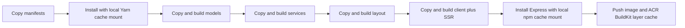

# MorWalPizVideo Client BuildKit Cache Handoff

## Outcome

Optimize the public MorWalPizVideo client's container build and its production image workflow while preserving the current Node 22 Alpine runtime, SSR output, runtime configuration injection, image tags, Azure Container Registry ownership, Azure Web App deployment, tests, checked pre-build, and visual behavior.

Assumptions:

- `MorWalPizVideo.ServerAPI/Dockerfile` and ServerAPI workflows remain on hold and are not changed by this work.
- Azure Container Registry remains the remote BuildKit cache backend. Adding a second GitHub Actions cache backend is not part of this change.
- The change is a build refinement, not a UI redesign or dependency upgrade.
- BuildKit/Buildx is the supported image builder for this deployment workflow.

## Current Evidence

- `frontend/morwalpizvideo.client/Dockerfile` is a two-stage Node 22 Alpine image. The builder copies the frontend workspace manifest, lockfile, and four relevant package manifests before the first frozen Yarn install, providing a stable dependency layer.
- The Docker build copies all three shared-package source trees before building models, services, and layout. A change in any one shared package therefore invalidates all subsequent shared build layers instead of respecting the repository's models -> services/layout dependency order.
- The first Yarn workspace install already creates links to the shared package directories. Their manifests export `dist` paths, and the Dockerfile builds those outputs in place. The later forced Yarn reinstall does not create a new dependency set or workspace location and is duplicate work.
- The image build deliberately uses `build-uncheck` after shared-package builds. The deployment workflow separately runs tests and the checked `build:all` before authenticating to Azure or building the image; this existing gate must remain.
- The production stage creates a minimal Express package at build time, installs it with npm, copies only `dist`, `dist-ssr`, and `server.mjs`, exposes port 80, and starts the SSR server. Cache contents and builder dependencies are not copied into the final image.
- `.github/workflows/deploy-morwalpizvideo-client.yml` already sets up Buildx and imports/exports an Azure Container Registry cache with `mode=max`. Cross-run BuildKit layer caching is therefore already enabled; `type=gha` would duplicate the existing remote cache.
- The workflow uses `docker/build-push-action@v5`; the repository already uses v6 for the Shooting Range client, establishing a current local precedent.
- The workflow builds from `frontend` context. Therefore `frontend/.dockerignore`, not the nested client `.dockerignore`, controls this image context. It excludes dependency directories, build outputs, environment files, and Dockerfiles from transferred context.
- Production deployment consumes the pushed container image by immutable commit SHA. Unlike ServerAPI, improving this Docker workflow directly affects the public client's production delivery path.
- `frontend/morwalpizvideo.client/DESIGN.md` is the incumbent visual authority. No app-local `PRODUCT.md` exists. This change must not alter rendered UI or the established editorial design system.

Current build flow:

```mermaid
flowchart LR
    M[Copy manifests] --> I[Install workspaces]
    I --> A[Copy all shared sources]
    A --> BM[Build models]
    BM --> BS[Build services]
    BS --> BL[Build layout]
    BL --> RI[Force reinstall all workspaces]
    RI --> C[Copy and build client plus SSR]
    C --> N[Install Express in runtime stage]
    N --> P[Push image and registry cache]
```

## Proposed Design

Keep the two-stage image and current deployment ownership, with these bounded changes:

1. Declare a stable Dockerfile frontend that supports cache mounts.
2. Preserve the manifest-first frozen Yarn install and attach a client-specific, locked Yarn cache mount at Yarn Classic's cache root. This benefits local or other persistent builders without committing cache files into image layers.
3. Copy and build shared packages in dependency order: models first, services second, and layout third. Each package source copy should immediately precede its build so unrelated downstream package changes do not invalidate upstream build layers.
4. Remove the second forced Yarn install. The original workspace links already target the package directories whose `dist` outputs have just been created.
5. Preserve the client source-copy set, `build-uncheck`, SSR build, output directories, and runtime copy behavior.
6. Attach a separate client-specific, locked npm cache mount to the runtime-stage Express installation. Do not copy npm cache data into the final filesystem.
7. Upgrade `docker/build-push-action` from v5 to v6. Keep `docker/setup-buildx-action@v3`, the current image tags, push behavior, Docker context, Dockerfile path, ACR registry cache reference, and `mode=max` export.
8. Do not add `type=gha`. A second remote cache adds quota, eviction, and troubleshooting paths without replacing a missing capability.
9. Do not add cache-mount export/import tooling. BuildKit registry layer caching can skip an unchanged install layer, but mutable cache-mount contents are not claimed as persistent across fresh GitHub-hosted runners.

Expected build flow:

Material alternative: switching from the ACR cache to GitHub Actions cache would also persist BuildKit layers, but the workflow already authenticates to ACR and maintains a dedicated image cache reference. Changing cache providers adds operational churn without an identified failure in the current backend.

Impeccable planning lens: this is an `Experience` surface and an explicit refinement. The narrow applicable workflow is `optimize`, using the incumbent `frontend/morwalpizvideo.client/DESIGN.md`. No visual artifacts are changed. Implementation evidence must include desktop and mobile smoke captures of the same deployed SSR route only to prove that image/build changes did not alter rendering, responsive behavior, or hydration.

## Impacted Projects

- **frontend/morwalpizvideo.client:** Docker build layering and production image creation change; application source and UI remain unchanged.
- **frontend/fe-packages/models:** Verify-only shared build input; its image layer becomes independently cacheable.
- **frontend/fe-packages/services:** Verify-only shared build input; it remains downstream of models.
- **frontend/fe-packages/layout:** Verify-only shared build input; it remains downstream of models and supplies the public UI.
- **GitHub Actions deployment:** The public-client production workflow upgrades its Docker build action while retaining tests, checked builds, Azure authentication, ACR push, and Web App deployment.
- **Azure Container Registry:** Continues to store immutable SHA/latest images and the mutable BuildKit cache reference.
- **Azure Web App for the public client:** Receives an equivalent image addressed by the same SHA tag.
- **MorWalPizVideo.ServerAPI and its workflows:** Explicitly not affected; the previous experiment remains on hold.
- **Other frontend applications and backend projects:** Not affected.

Independent post-validation review is warranted because the workflow pushes and deploys a production image. Review should focus on cache isolation, preserved image tags, deployment ordering, and evidence that no credential or builder cache enters the final image.

## Impacted Files

### Modify

- `frontend/morwalpizvideo.client/Dockerfile` - add BuildKit package-cache mounts, improve shared-package layer boundaries, remove the duplicate forced install, and preserve the runtime contract.
- `.github/workflows/deploy-morwalpizvideo-client.yml` - upgrade the Docker build action to v6 while retaining the existing ACR cache and deployment behavior.
- `docs/architecture/deployment.md` - record the optimized public-client image path and distinguish ACR layer-cache persistence from builder-local package cache mounts after validation.

### Add

- None for implementation. This handoff is the task-local planning artifact.

### Generated/Migration

- None.

### Documentation

- `docs/feature-handoffs/morwalpizvideo-client-buildkit-cache-handoff.md` - implementation boundary, evidence, validation results, timings, and residual risks.

### Verify Only

- `frontend/package.json` - confirms Yarn Classic workspace ownership and shared build order.
- `frontend/yarn.lock` - remains the frozen dependency source.
- `frontend/morwalpizvideo.client/package.json` - confirms checked/uncheck client and SSR scripts.
- `frontend/fe-packages/models/package.json` - confirms `dist` exports and models build.
- `frontend/fe-packages/services/package.json` - confirms models dependency and `dist` exports.
- `frontend/fe-packages/layout/package.json` - confirms shared output and peer dependencies.
- `frontend/.dockerignore` - effective ignore file for the selected Docker context; do not broaden context in this task.
- `frontend/morwalpizvideo.client/server.mjs` - runtime smoke owner; no source change.
- `frontend/morwalpizvideo.client/DESIGN.md` - visual no-regression authority; no design change.

## Impact Matrix

| Area | Impact |
|---|---|
| Backend/API | Not applicable; ServerAPI remains on hold and API behavior does not change. |
| Frontend/UI | No intended UI change. The same client and SSR bundles are produced from the same source and scripts. |
| Database/Data | Not applicable. |
| Contracts/Models | No contract change. Shared TypeScript packages remain build inputs in established dependency order. |
| Authentication/Authorization | No application auth change. Existing Azure OIDC login and ACR credentials remain in workflow-owned actions only. |
| Validation | Clean image build, warm cached build, package-specific invalidation, checked frontend build, tests, SSR runtime smoke, final-image inspection, and desktop/mobile visual smoke. |
| Cache | Builder-local Yarn/npm cache mounts are added; ACR remains the cross-run BuildKit layer cache. No GitHub Actions cache backend is added. |
| Configuration/Secrets | No new values or secrets. Cache keys must not contain credentials, and no secret-bearing files may enter the context or final image. |
| Logging/Telemetry | No runtime telemetry change. Buildx progress and workflow timings are validation evidence. |
| Background Jobs | Not applicable. |
| Deployment/Operations | Production image build action moves to v6; tags, registry, cache reference, push, and Web App deployment remain stable. |
| Backward Compatibility | Runtime command, port, Node major, SSR files, runtime environment injection, image names, and deployment target remain compatible. |

## Reuse Opportunities

- Reuse the current manifest-first dependency layer and frozen Yarn lockfile.
- Reuse the repository's established models -> services -> layout build order.
- Reuse `docker/setup-buildx-action@v3`, the existing ACR login, registry cache reference, and `mode=max` policy.
- Reuse the repository's existing `docker/build-push-action@v6` version precedent.
- Reuse the public-client tests and checked `build:all` gate before Azure login.
- Reuse the existing SSR server, immutable SHA image tag, `latest` compatibility tag, and Azure deployment action.

## Risks

- **Medium - Workspace resolution fails after removing the forced reinstall.** Cause: an undocumented dependency on relinking after shared output creation. Affected surface: Docker client and SSR builds. Mitigation: require a clean image build before accepting warm-cache evidence. Verification signal: both bundles build and the SSR process resolves all shared imports.
- **Medium - Cache improvement is overstated.** Cause: ACR layer cache and local cache mounts have different persistence semantics. Affected surface: performance reporting. Mitigation: report step-level cache hits separately from package-cache reuse and do not claim remote cache-mount persistence. Verification signal: Buildx logs identify imported ACR records and cached layers.
- **Medium - Shared-package invalidation is incorrect.** Cause: source-copy order omits a required upstream input. Affected surface: generated shared bundles. Mitigation: preserve package manifests at install time and copy each complete package directory before its build. Verification signal: clean build plus isolated models, services, and layout source-change scenarios produce expected downstream rebuilds.
- **Medium - Production workflow regression during action upgrade.** Cause: action-major behavior or input interpretation changes. Affected surface: image push and deployment. Mitigation: retain all existing inputs and verify produced SHA/latest tags and cache export before Azure deployment. Verification signal: workflow logs show successful push, cache export, and deployment of the SHA tag.
- **Low - Cache poisoning or stale output.** Cause: mutable remote cache reference. Affected surface: image correctness. Mitigation: BuildKit's content-addressed records, frozen lockfile, clean-build gate, and immutable deployed SHA. Verification signal: a no-cache build produces equivalent runtime behavior and output inventory.
- **Low - Registry cache storage growth.** Cause: `mode=max` retains intermediate records. Affected surface: ACR storage. Mitigation: retain one dedicated mutable cache reference and monitor registry retention/storage policy. Verification signal: cache remains under the intended repository/tag and old blobs follow ACR policy.
- **Low - Runtime drift.** Cause: accidental changes to final-stage files, port, or command. Affected surface: Azure startup and SSR. Mitigation: preserve final-stage contract and inspect the built image. Verification signal: noninteractive container startup serves SSR on port 80 with runtime API configuration injection.
- **Low - Visual or hydration regression.** Cause: changed bundle contents despite intended build-only scope. Affected surface: public site. Mitigation: compare desktop/mobile SSR and hydrated output on representative routes. Verification signal: no console hydration error, layout shift, missing asset, or design-system difference.

## Technical Debt

- The runtime stage generates an uncommitted package manifest with a semver range for Express and installs without a lockfile. This weakens image reproducibility but predates the cache work. It does not block this optimization; defer a pinned runtime-dependency design to a separate task.
- The deployment workflow performs a checked host build and then rebuilds bundles inside Docker. This duplicates compilation but provides an early quality gate independent of image construction. Preserve it in this task; changing artifact ownership would be a larger supply-chain redesign.
- The Docker image still uses `build-uncheck`; safety depends on the preceding checked workflow build. Preserve current behavior, but do not reuse this Dockerfile from an unverified delivery path without an equivalent typecheck gate.
- The nested `frontend/morwalpizvideo.client/.dockerignore` is not authoritative when the build context is `frontend`. This is potentially confusing but does not block the change. Defer consolidation unless context contents become a measured bottleneck.
- Mutable BuildKit cache mounts are not exported across hosted runners by the current registry-cache design. Layer caching supplies the cross-run acceleration. Add cache-mount export tooling only if measured manifest-change restores justify its complexity.

## Implementation Roadmap

1. **Capture baseline.** Record one clean image build and one warm build using the current workflow-equivalent context, along with image size and the steps invalidated by a layout-only change. Gate: current image builds, starts, and serves SSR before edits.
2. **Add BuildKit package caches.** Update the client Dockerfile frontend and add separate locked, client-specific Yarn and npm cache mounts at their established cache roots. Gate: a clean build succeeds without cache contents appearing in output layers.
3. **Improve shared layer ownership.** Reorder complete shared-package source copies so each immediately precedes its dependency-ordered build. Gate: models changes rebuild all dependent packages, services changes do not rebuild models, and layout-only changes do not rebuild models or services.
4. **Remove duplicate installation.** Delete the forced second Yarn install while preserving the original frozen install and every bundle command. Gate: clean client and SSR builds resolve shared `dist` exports and produce both output directories.
5. **Upgrade workflow action.** Move the public-client image build to `docker/build-push-action@v6`; preserve Buildx setup, context, Dockerfile, push, tags, ACR cache import/export, and deployment ordering. Gate: workflow syntax is valid and an authorized run pushes SHA/latest plus the build cache.
6. **Verify runtime equivalence.** Start the built image with representative runtime API configuration and verify port 80, static assets, SSR HTML, hydration, runtime `env-config.js`, and graceful SSR fallback behavior. Gate: behavior matches baseline and no builder files or cache directories exist in the final image.
7. **Measure cache behavior.** Compare clean, unchanged warm, client-source-only, layout-only, services-only, and lockfile-change scenarios. Gate: logs show the expected layer reuse; report elapsed times as environment-specific evidence rather than a universal guarantee.
8. **Run frontend and visual gates.** Execute the existing public-client tests and checked client/SSR build, then apply the Impeccable `optimize` verification lens without changing UI: representative desktop and mobile captures, responsive layout, asset loading, hydration, and console checks. Gate: no functional or visual regression.
9. **Update documentation and stop.** Record actual workflow run, timings, image size, cache-hit evidence, files changed, and residual risks in this handoff and deployment architecture. Do not modify ServerAPI, sibling Dockerfiles, shared source, or cache-provider policy.

Completion boundary: the task is complete when the two implementation files and documentation are updated, all local executable gates pass, and one authorized GitHub Actions run proves image push, ACR cache export/import, and Azure deployment. Any dependency pinning, cache-provider migration, Docker context redesign, or sibling rollout requires separate approval.

## Testing Strategy

- **Dockerfile/static:** verify the frontend directive, manifest-first install, unique locked cache IDs, dependency-ordered source copies/builds, absence of the forced reinstall, unchanged bundle commands, and unchanged final-stage contract.
- **Clean integration:** build without imported layer cache to prove the image is self-contained and workspace links do not depend on prior builder state.
- **Warm integration:** rebuild unchanged with the ACR cache imported; dependency and bundle layers should report cache reuse.
- **Invalidation:** change client source, layout source, services source, models source, and the lockfile independently in disposable validation states. Each scenario must rebuild only its logical layer and downstream dependents.
- **Frontend tests:** use the existing `morwalpizvideo.client` Vitest suite with the nonempty-suite requirement.
- **Checked build:** retain the existing shared build followed by the public client's checked client and SSR build before Azure authentication.
- **Runtime smoke:** verify the SSR root and one content route, static asset delivery, runtime environment generation, API base injection, port 80, and absence of hydration errors.
- **Security:** inspect image history/filesystem for source trees, Yarn/npm caches, environment files, credentials, and builder toolchains. None should be present beyond the intended Node runtime and installed Express production dependency.
- **Workflow contract:** verify immutable SHA and `latest` image tags, ACR cache import/export, deployment by SHA, and Azure logout on completion or failure.
- **Visual evidence:** use the incumbent `DESIGN.md` at representative desktop and mobile widths. Compare first viewport, responsive navigation, media assets, and typography; this is regression proof, not a redesign pass.
- **Performance reporting:** capture total build time plus install/shared/client/runtime-stage timings for clean and warm runs. Cache-hit structure is the acceptance signal; timing changes are supporting evidence because hosted-runner and registry latency vary.

No new unit or component test source is required unless implementation exposes behavior not covered by the existing build, SSR smoke, and workflow gates.

## Migration And Rollback

- **Database/API/contracts/auth:** no migration or compatibility window is required.
- **Cache transition:** continue using the same ACR build-cache reference, so no cache warm-up migration is required. The first build after Dockerfile/action changes may repopulate invalidated records.
- **Deployment order:** merge only after clean local/controlled Buildx validation; allow the existing workflow to test, build, push by SHA, export cache, and deploy in its current order.
- **Rollback:** revert the Dockerfile and workflow changes, then redeploy the previous immutable image SHA. Cache records may be discarded without data recovery.
- **Failure containment:** a cache import/export failure must fail the image job rather than deploy an unverified tag. An application or hydration regression is recovered by redeploying the prior SHA; no database rollback is involved.
- **Monitoring:** verify workflow duration, cache import/export, Azure startup logs, SSR response, static assets, and browser hydration after the first deployment.
- **Rollout limit:** do not propagate this pattern to sibling frontend images or ServerAPI until the recorded evidence is reviewed and separately approved.

## Open Questions

None identified. The existing ACR cache backend, image ownership, runtime contract, validation gates, and implementation boundary provide a complete implementation decision. Timing improvements should be recorded, but no arbitrary percentage threshold should override correctness and expected step-level cache reuse.

## Implementation Status

- Implemented the Dockerfile cache and layer changes: added the BuildKit frontend, locked client-specific Yarn/npm cache mounts, dependency-ordered shared-package copies and builds, and removed the duplicate forced Yarn install.
- Updated the deployment workflow to `docker/build-push-action@v6` while preserving Buildx setup, ACR cache import/export, image tags, push behavior, and Azure deployment by SHA.
- Updated the deployment architecture note to describe the public-client cache behavior and keep ServerAPI explicitly on hold.
- Focused frontend validation passed: `yarn --cwd frontend workspace morwalpizvideo.client test --passWithNoTests=false` ran 18 tests across 6 files with 0 failures, and `yarn --cwd frontend build:shared && yarn --cwd frontend workspace morwalpizvideo.client build:all` completed successfully.
- Docker Buildx is installed, but both `docker buildx build --check` and the local image build are blocked because the Docker daemon is unreachable. No image, runtime smoke, clean/warm cache measurement, or final-image inspection was claimed.
