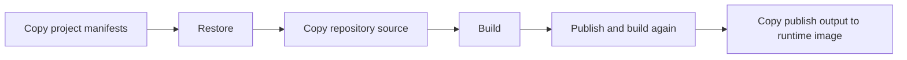
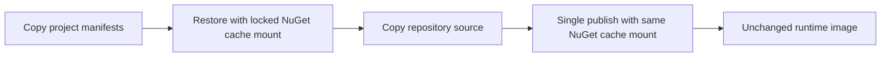

# ServerAPI BuildKit Cache Handoff

**Status: On hold.** Do not expand or continue ServerAPI Docker/workflow optimization without new user approval. The active cache-optimization target is the public-client handoff in `docs/feature-handoffs/morwalpizvideo-client-buildkit-cache-handoff.md`.

## Outcome

Optimize only `MorWalPizVideo.ServerAPI/Dockerfile` as a bounded experiment in faster local and persistent-builder image builds. Preserve the .NET 10 runtime image, Release default, final entry point, exposed ports, non-root runtime user, project graph, and published application behavior.

Assumptions:

- The experiment targets Docker BuildKit or Buildx; legacy Docker builders are not an acceptance target.
- "Internal cache" means a BuildKit cache mount owned by the builder, not a new registry or GitHub Actions cache backend.
- No workflow, `.dockerignore`, project, application source, or sibling Dockerfile changes are in scope.
- Success requires measured cold and warm behavior, not merely a syntactically valid Dockerfile.

## Current Evidence

- `MorWalPizVideo.ServerAPI/Dockerfile` is a .NET 10 multi-stage build with separate restore, build, publish, and final stages. It copies project manifests before source, so package restore already has a useful layer-cache boundary.
- The Dockerfile runs `dotnet build` and then `dotnet publish` without suppressing publish's build, allowing compilation work to be repeated.
- `MorWalPizVideo.ServerAPI/MorWalPizVideo.ServerAPI.csproj` targets `net10.0` and directly references Contracts, Domain, Models, MvcHelpers, and ServiceDefaults.
- `MorWalPizVideo.Domain/MorWalPizVideo.Domain.csproj` transitively references YouTubeUtilities. The Dockerfile already copies all seven required project manifests before restore; that closure must be preserved.
- No repository-level `Directory.Build.*`, `Directory.Packages.props`, root NuGet configuration, or .NET package lock file was found. The copied project manifests are therefore the verified restore inputs currently present in source.
- The root `.dockerignore` excludes only credential JSON patterns. The Dockerfile's repository-wide source copy can still receive unrelated outputs and changes; this is a known limit of a Dockerfile-only experiment.
- `.github/workflows/ci.yml` performs a clean ServerAPI container build with `--no-cache`. Its purpose is clean-build correctness, not warm-cache performance.
- `.github/workflows/deploy-serverapi.yml` restores, builds, and publishes with the .NET CLI and deploys a publish directory to Azure Web App. It does not build or deploy the Dockerfile.
- Other frontend deployment workflows use Buildx registry cache export/import, but no backend Dockerfile currently uses a BuildKit cache mount. Those workflows and Dockerfiles are out of scope.

Current build flow:

## Proposed Design

Keep the existing multi-stage ownership and change only the ServerAPI Dockerfile:

1. Declare the stable BuildKit Dockerfile frontend required for cache-mount instructions.
2. Retain the manifest-first copy order and complete seven-project restore closure.
3. Give the NuGet global packages cache a ServerAPI-specific BuildKit cache identity, target `/root/.nuget/packages`, and use locked sharing to avoid concurrent writer corruption on a shared builder.
4. Attach the same cache mount to every SDK operation that needs restored package contents. A cache mount is not committed into the image layer, so mounting it only during restore would leave publish unable to consume those packages reliably.
5. Preserve restore as its own layer, then copy source and run one Release publish with restore disabled. This makes publish the single compilation operation and writes directly to the existing publish output directory.
6. Preserve the final ASP.NET runtime stage, `app` user, ports, work directory, copied publish output, and DLL entry point exactly.
7. Do not add a remote cache exporter, inline cache metadata, package locking, source filtering, secret mount, extra build argument, or sibling Dockerfile abstraction in this experiment.

Expected flow:

Material alternative: retaining separate build and publish stages with publish configured not to build would preserve stage semantics but requires compatible intermediate output placement and offers no advantage for this production image. A single publish is smaller and less error-prone for the experiment.

## Impacted Projects

- **MorWalPizVideo.ServerAPI:** Build-time behavior only; runtime code and API contracts remain unchanged.
- **MorWalPizVideo.Domain, MorWalPizVideo.Models, MorWalPizVideo.MvcHelpers, MorWalPizVideo.ServiceDefaults, MorWalPizVideo.YouTubeUtilities, MorWalPiz.Contracts:** Restore/build inputs only; no project changes.
- **MorWalPizVideo.BackOffice.Tests:** No test-source change. Existing ServerAPI-related behavior tests remain the runtime regression owner.
- **MorWalPizVideo.AppHost:** No change; verify-only because local orchestration consumes ServerAPI.
- **Frontend workspaces and standalone tools:** Not affected.
- **Azure deployment surface:** Not affected because the ServerAPI deployment workflow does not use this Dockerfile.

## Impacted Files

### Modify

- `MorWalPizVideo.ServerAPI/Dockerfile` - add BuildKit cache semantics and reduce restore/build/publish work while preserving the runtime image contract.

### Add

- None.

### Generated/Migration

- None.

### Documentation

- `docs/feature-handoffs/serverapi-buildkit-cache-handoff.md` - implementation boundary, evidence, and validation record. After implementation, append actual timings, cache-step evidence, files changed, and residual risks here.

### Verify Only

- `.dockerignore` - confirms the known repository-context limitation; do not change in this experiment.
- `.github/workflows/ci.yml` - clean container build must remain valid; no workflow change.
- `.github/workflows/deploy-serverapi.yml` - confirms production deployment remains non-containerized; no workflow change.
- The seven project manifests copied before restore - confirm the restore closure remains complete.
- `docs/architecture/deployment.md` - no update is required unless implementation changes CI or deployment policy beyond this handoff.

## Impact Matrix

| Area | Impact |
|---|---|
| Backend/API | Build-only optimization; routes and behavior unchanged. |
| Frontend/UI | Not applicable. |
| Database/Data | Not applicable; no model, persistence, or migration change. |
| Contracts/Models | No contract change; manifests remain restore inputs. |
| Authentication/Authorization | No runtime change; preserve non-root final-stage execution. |
| Validation | Dockerfile parse, clean build, warm-cache scenarios, image startup, and existing ServerAPI behavior gate. |
| Cache | Adds builder-local NuGet package caching. Normal layer caching remains responsible for unchanged restore and publish steps. |
| Configuration/Secrets | No secret or application configuration change. Cache contents must contain only restored public/private package artifacts already available to the builder; no credentials may be copied into an image layer. |
| Logging/Telemetry | No application telemetry change. BuildKit plain progress and elapsed timing are test evidence only. |
| Background Jobs | Not applicable. |
| Deployment/Operations | Production deployment is unchanged. Ephemeral CI runners receive no cross-run acceleration without a future external cache backend. |
| Backward Compatibility | Final image command, ports, user, framework, and output must remain compatible. |

## Reuse Opportunities

- Reuse the current manifest-first restore boundary and complete transitive project list.
- Reuse the current .NET 10 SDK and ASP.NET runtime images.
- Reuse the current Release build argument, publish output directory, final runtime stage, and entry point.
- Reuse the central clean-container gate and ServerAPI-related backend test filter as correctness checks.
- If this experiment succeeds, its measured pattern can inform a separately approved rollout to other backend Dockerfiles; do not generalize it during this task.

## Risks

- **Medium - Cache appears ineffective:** Unchanged builds may be served by normal layer cache, hiding whether the NuGet cache mount works. Mitigation: include a project-manifest-change scenario that forces restore while preserving downloaded packages. Signal: restore executes but reports reused/local package availability and improves relative to cold restore.
- **Medium - Publish cannot find packages:** Cache mounts are ephemeral to each instruction. Mitigation: mount the same cache during restore and publish. Signal: clean build succeeds without an implicit second restore.
- **Medium - Performance claim does not apply to CI:** the clean gate uses `--no-cache` on an ephemeral runner and deployment bypasses Docker. Mitigation: report local or persistent-builder results explicitly and make no CI/deployment speed claim. Signal: handoff records builder type and scenario timings.
- **Medium - Broad source copy limits cache hits:** root ignore rules do not exclude normal build outputs or unrelated repository files. Mitigation: keep this as a documented limitation and evaluate Dockerfile-specific ignore rules only in a future, separately scoped change. Signal: BuildKit progress shows source-copy invalidation after unrelated changes.
- **Low - Concurrent cache mutation:** parallel builds sharing one NuGet cache can contend or corrupt writes. Mitigation: use locked cache sharing and a ServerAPI-specific cache identity. Signal: parallel persistent-builder builds complete without package-cache errors.
- **Low - Runtime drift:** changing stages could accidentally alter user, ports, entry point, or publish contents. Mitigation: preserve final stage verbatim and compare runtime smoke behavior. Signal: container starts as non-root and serves the expected health/API surface.
- **Low - Secret retention:** package-source credentials could be mishandled if future authenticated feeds are introduced. Mitigation: do not add credentials or secret-bearing build arguments; use a separate BuildKit secret design if authenticated feeds become necessary. Signal: image history and final filesystem contain no credentials.

## Technical Debt

- The minimal root `.dockerignore` permits a large/noisy repository context. It does not block this experiment, but it limits maximum speed and cache stability. Defer because the user explicitly constrained changes to one Dockerfile.
- ServerAPI production deployment does not consume the Docker image. This does not block a Dockerfile experiment, but production build-time benefits are zero until a separately approved deployment change.
- CI intentionally disables normal layer reuse and runs on an ephemeral host. Preserve this correctness gate; a future CI acceleration proposal would need Buildx plus an explicit GitHub Actions or registry cache policy.
- Sibling backend Dockerfiles retain duplicate build/publish work. Defer until this experiment has recorded evidence and the user approves wider adoption.

## Implementation Roadmap

1. **Establish baseline evidence.** On one BuildKit builder, record a cold ServerAPI image build, an unchanged warm build, and the final image size. Gate: clean build succeeds and the current image starts normally.
2. **Enable BuildKit cache semantics.** Modify only `MorWalPizVideo.ServerAPI/Dockerfile` to declare the stable frontend and add a locked, ServerAPI-specific NuGet cache mount to restore and publish. Preserve all manifest copies. Gate: Dockerfile parses under BuildKit and a clean restore/publish succeeds.
3. **Remove duplicate compilation.** Replace the separate build plus rebuilding publish path with one publish that consumes the explicit restore result. Preserve Release configurability and the existing publish destination. Gate: logs show one compilation path and no implicit restore during publish.
4. **Verify runtime equivalence.** Build from a clean state, start the final image, verify the expected process, ports, anonymous health/API response used by the existing environment, and non-root identity. Gate: no runtime-contract difference from baseline.
5. **Measure cache behavior.** Repeat unchanged, source-only-change, and project-manifest-change scenarios on the same builder. Gate: unchanged steps are cached; source-only changes do not rerun restore; manifest changes rerun restore while reusing the NuGet cache mount.
6. **Run repository regression gates.** Keep the central clean-container scenario valid and run the existing ServerAPI-related backend test selection. Gate: nonempty tests pass and clean image build succeeds.
7. **Record and stop.** Append builder details, scenario timings, cache evidence, image size, and residual limitations to this handoff. Do not update workflows, `.dockerignore`, application projects, or other Dockerfiles. Further rollout requires separate approval.

Independent post-validation review is not required for this one-file build-only experiment if all gates pass. It becomes warranted before repository-wide rollout because cache identity, concurrency, CI persistence, and context filtering would then affect multiple delivery paths.

## Testing Strategy

- **Dockerfile/static:** verify the BuildKit frontend supports cache mounts, every cache consumer mounts the same target, the project-manifest closure remains complete, and final-stage runtime settings are unchanged.
- **Cold integration:** build with no reusable layer/package cache to prove the image is self-contained and does not rely on workstation state.
- **Warm integration:** rebuild unchanged on the same builder and capture cached-step evidence and elapsed time.
- **Source invalidation:** change only ServerAPI source in a disposable test state; restore must remain cached while publish reruns.
- **Manifest invalidation:** change a package/project manifest in a disposable test state; restore must rerun and use the persistent NuGet cache without stale-package failures.
- **Runtime smoke:** start the final image, verify process startup, non-root execution, exposed endpoint behavior, and graceful failure when required runtime configuration is absent.
- **Behavior regression:** execute the existing `MorWalPizVideo.BackOffice.Tests` ServerAPI/Shared/CrossApi selection and confirm the selection is nonempty.
- **Security:** inspect final image history/filesystem for accidental source, NuGet cache, SDK, or credentials. The final image should contain only published output over the ASP.NET runtime base.
- **Performance reporting:** compare cold and warm timings on the same builder and host. Report absolute times and percentage change; do not compare different runners or infer production deployment gains.

No new unit, component, contract, migration, or end-to-end test code is required because application behavior and contracts do not change.

## Migration And Rollback

- **MongoDB/SQLite/API contracts/auth/cache/configuration:** no migration or compatibility window is required; none of these runtime surfaces change.
- **Deployment order:** merge only after clean and warm BuildKit validation. Existing Azure deployment remains unchanged.
- **Rollback:** revert the single Dockerfile optimization to restore the previous build pipeline. No data or configuration recovery is required.
- **Cache recovery:** a corrupted or suspect builder cache may be discarded without affecting source or runtime data; the next build must reconstruct all packages from configured feeds.
- **Rollout limit:** stop after ServerAPI evidence is recorded. Do not propagate the pattern to BackOffice or other images until the user evaluates the result.

## Open Questions

- Which persistent builder will be used for the timing experiment: local Docker Desktop/Engine, a self-hosted builder, or a Buildx builder? This changes the persistence and concurrency evidence, but not the Dockerfile design.
- What quantitative threshold will count as success: warm elapsed-time reduction, restore-time reduction after manifest invalidation, or both? Record the threshold before comparing results to avoid selecting only favorable measurements.

## Implementation Status

- Updated `MorWalPizVideo.ServerAPI/Dockerfile` only for build behavior: added the BuildKit frontend directive, added a locked ServerAPI-specific NuGet cache mount to restore and publish, removed the separate build stage, and made publish the single compilation operation with `--no-restore`.
- Preserved the seven project-manifest copies, Release configuration default, .NET 10 SDK/runtime images, non-root `app` user, exposed ports, publish destination, and DLL entry point.
- Validation is intentionally deferred pending user approval. This server has Docker installed without the Buildx component, so BuildKit checks and image builds cannot run here until Buildx is available.

## Validation Record - 2026-11-04

- Buildx is installed and available (`Docker 29.9.3`).
- Dockerfile structure checks passed: the BuildKit syntax directive, seven manifest copies, both matching locked NuGet cache mounts, publish `--no-restore`, absence of `dotnet build`, runtime user, ports, and DLL entry point are all present as intended.
- Focused regression tests passed: `dotnet test MorWalPizVideo.BackOffice.Tests/MorWalPizVideo.BackOffice.Tests.csproj --configuration Release --filter "Category=TestGroup:ServerAPI|Category=TestGroup:Shared|Category=TestGroup:CrossApi" --verbosity minimal` executed 62 tests with 0 failures and 0 skips.
- Docker BuildKit check and image build remain blocked because the daemon is unreachable at `/var/run/docker.sock`. Runtime smoke, cold-build, warm-build, cache invalidation, image-size, and final-image security checks therefore remain pending until the Docker daemon is running and accessible.

## GitHub Actions Cache Decision

The Dockerfile cache mount and a GitHub Actions cache exporter solve different persistence problems:

- The NuGet `RUN --mount=type=cache` reuses package files within the same persistent BuildKit builder. A fresh GitHub-hosted runner does not retain that builder between workflow runs.
- `docker/setup-buildx-action` plus `docker/build-push-action` with `cache-from: type=gha` and `cache-to: type=gha,mode=max` imports and exports BuildKit build records and layers across workflow runs.
- The GitHub Actions exporter does not, by itself, guarantee persistence of the mutable `/root/.nuget/packages` cache-mount contents. It can still avoid restore entirely when the restore layer is reusable. Persisting cache-mount contents across runners after a manifest invalidation requires a separately justified cache-mount export/import mechanism and is not included in the minimal workflow option.

Current repository constraints:

- `.github/workflows/ci.yml` intentionally uses `docker build --no-cache` for BackOffice, ServerAPI, and FreezerAnalysis as a clean-build correctness gate. Adding `cache-from` while retaining `no-cache` would not provide the intended layer-cache acceleration.
- Replacing that ServerAPI clean build with a cache-enabled Buildx build would improve repeat CI builds but would remove the current clean-build guarantee from normal CI.
- `.github/workflows/deploy-serverapi.yml` deploys a .NET publish directory to Azure Web App and does not build the Dockerfile. Workflow cache changes in central CI therefore do not accelerate the production deployment job.

Recommended follow-up if CI acceleration is approved:

1. Keep BackOffice and FreezerAnalysis behavior unchanged.
2. Split ServerAPI out of the clean-container matrix into a cache-enabled Buildx job using `docker/setup-buildx-action@v3` and `docker/build-push-action@v6` with a ServerAPI-specific GitHub Actions cache scope.
3. Retain ServerAPI clean-build coverage in a scheduled or manually dispatched gate, or explicitly accept its removal from every push and pull request. Do not run both jobs on every change if elapsed CI time and runner consumption are the optimization target.
4. Measure at least two runs on the same branch and inspect BuildKit step cache hits. Treat this as layer-cache evidence only; do not claim cross-run NuGet cache-mount persistence without a manifest-invalidation experiment.
5. Update `docs/architecture/deployment.md` when the CI gate policy changes.

This follow-up expands the accepted one-Dockerfile boundary and requires explicit approval before `.github/workflows/ci.yml` is changed.