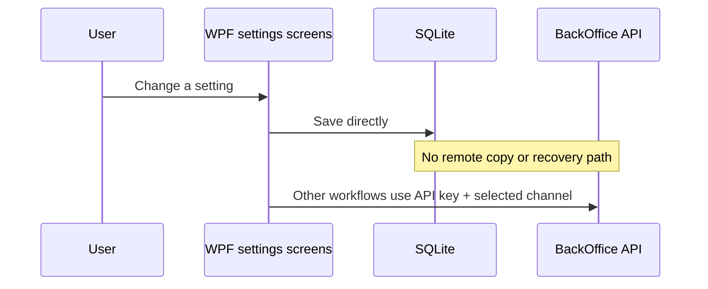
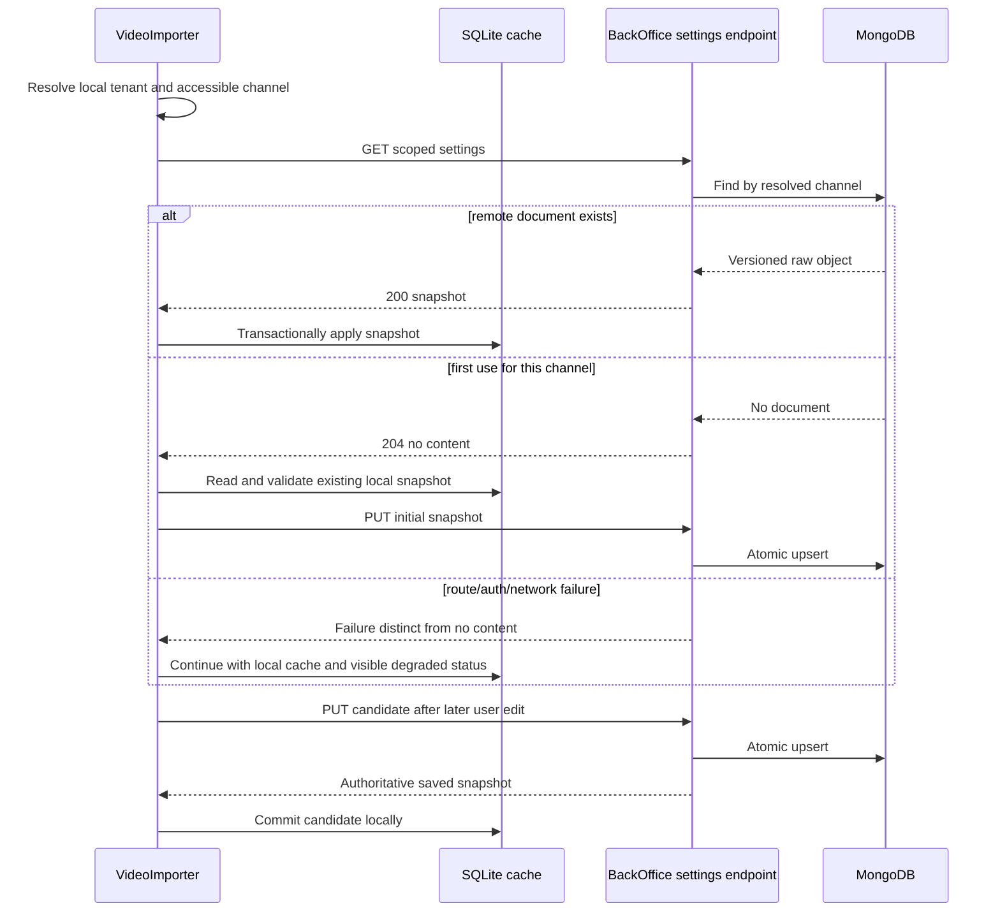

# VideoImporter Channel Settings Synchronization Handoff

### Outcome

Centralize VideoImporter configuration that is genuinely owned by a selected channel in BackOffice MongoDB, while retaining local SQLite only as a recoverable working cache. On startup and after a tenant/channel switch, the importer resolves the selected channel and pulls its remote settings. User changes are written to BackOffice before they are committed locally, so a reported successful save is durable across machines.

Assumptions for the first release:

- The synchronized snapshot contains the channel preferences currently edited in the general settings, languages/disclaimers, and publish-schedule screens.
- API endpoint, API key, Key Vault configuration, YouTube credentials, provider access tokens, machine paths, fake-mode flags, prompt-template files, dialog history, hashtag usage history, and current tenant selection remain local or secret-managed because they are credentials, machine state, or operational history rather than channel settings.
- `ApplicationName` and `DefaultHashtags` are channel settings. `ApiEndpoint`, `ApiKey`, and `ChannelId` are bootstrap/scope inputs and must not be copied into the remote raw object.
- The BackOffice stores an opaque JSON object in a dedicated aggregate, but the importer owns a versioned typed snapshot internally so local IDs and secrets cannot leak accidentally.
- There is one active importer writer at a time, as stated by the requester. Optimistic concurrency and merge UI are therefore out of scope; atomic idempotent upsert is still required for retries.
- No BackOffice admin SPA UI is added.

Completion boundary: stop when the versioned API-key endpoint, Mongo persistence, importer pull/seed/save workflow, local-cache recovery, focused tests, rollout documentation, and operational index evidence are complete. Synchronizing secrets, social credentials, image-generation configuration, prompt templates, history, or arbitrary local files requires separate approval.

### Current Evidence

- `MorWalPiz.VideoImporter/App.xaml.cs` builds configuration from JSON, user secrets, environment variables, and optional Key Vault; initializes SQLite before resolving `ApiSettings`; and prefers external `ApiEndpoint`, `ApiKey`, and `ChannelId` values over the local `Settings` row.
- `MorWalPiz.VideoImporter/Models/Settings.cs` currently mixes channel preferences (`DefaultHashtags`, `ApplicationName`) with bootstrap/sensitive values (`ApiEndpoint`, `ApiKey`, `ChannelId`).
- `MorWalPiz.VideoImporter/Data/AppDbContext.cs` stores `Settings`, `Language`, `Disclaimer`, and `PublishSchedule` in SQLite under tenant query filters. It seeds two tenants and default configuration rows. `DatabaseService.InitializeDatabase` applies EF migrations without deleting the database.
- `MorWalPiz.VideoImporter/Services/TenantContext.cs` persists only the selected local tenant ID/name in `tenant-settings.json`. `Tenant.ChannelId` is stored separately in SQLite.
- `MorWalPiz.VideoImporter/MainWindow.xaml.cs`, `LoadTenantsAsync`, and `EnsureTenantChannelAsync` establish the startup order: load the local tenant, discover accessible channels when no channel is stored, persist the selected channel locally, then continue initialization. Channel changes currently do not trigger a settings synchronization.
- `App.GetCurrentChannelId` resolves the selected tenant's stored `ChannelId` and falls back to `ApiSettings.ChannelId`.
- `MorWalPiz.VideoImporter/Services/ApiService.cs` already uses the factory-managed `BackOffice` client and sends `X-API-Key` and `X-Channel-Id`. It can therefore own the new GET/PUT calls without another HTTP stack.
- `SettingsPage.xaml.cs` constructs a new `TenantContext` and `DatabaseService` instead of using the host-owned instances. This can read or write a different tenant context and must be corrected when the save path is centralized.
- `LanguagesPage.xaml.cs`, `LanguageEditDialog.xaml.cs`, `DisclaimerPage.xaml.cs`, and `PublishSchedulesPage.xaml.cs` write directly to SQLite at multiple points. A synchronization service must become the write boundary; adding a final push only to the general settings screen would leave other channel settings divergent.
- `Language.Id`, `Disclaimer.LanguageId`, and `PublishSchedule.Id` are local SQLite identifiers. The remote snapshot must use language code and value-based schedule records, not those IDs. Disclaimer text can be nested under its language entry.
- `HashtagHistory` is usage history keyed by tenant/channel, not configuration. `SocialChannelConfiguration` contains an access token. Neither belongs in the raw settings object.
- `ImageGenerationOptions` combines provider endpoint/model, secret name, machine output directory, and rendering defaults. It has no channel-aware persistence or settings UI and is excluded from this first boundary.
- `MorWalPizVideo.BackOffice/Services/ChannelContext.cs` already resolves `X-Channel-Id`, restricts API-key principals to their persisted `ApiKey.ChannelId`, returns `400 channel_context_required` for a missing header, and conceals unavailable/inaccessible channels with `404 channel_context_unavailable`.
- `MorWalPizVideo.BackOffice/Controllers/SocialAssetsController.cs` is the nearest machine-client pattern: `[ApiKeyAuth]`, `[RequireChannelScope]`, explicit scope checks, a focused service, and a channel ID derived from `HttpContext.GetChannelContext()`.
- `ApiKeyAuthenticationHandler` emits the API key's scopes as `scope` claims. Dedicated read/write scopes can protect the new endpoint without granting access to the generic configuration API.
- `ConfigurationController` and `MorWalPizConfiguration` are global, arbitrary-key administrative configuration surfaces. They are not channel scoped, use browser RBAC permissions, and are therefore not a safe reuse target.
- `MorWalPizVideo.Models`, `MorWalPizVideo.Domain`, and `MorWalPizVideo.BackOffice` already use model -> repository -> focused service/controller ownership. Mock and Mongo repository registrations are selected in `BackOffice/Program.cs`.
- `MorWalPiz.Contracts` is already referenced by both BackOffice and VideoImporter and is the correct owner for the request/response envelope.
- `docs/architecture/windows-apps.md` defines SQLite compatibility, Generic Host/DI, factory-managed HTTP, API-key authentication, and incremental movement away from static child-window dependencies. ADR-012 requires touched WPF behavior to move toward injectable/testable services without a wholesale MVVM rewrite.
- `docs/architecture/backend.md`, `api-design.md`, and `security.md` require explicit DTOs, API-key/channel scoping, least-privilege scopes, and secret exclusion. ADR-008 requires source-controlled, manually applied Mongo indexes rather than startup creation.
- The current importer test project contains startup/tenant/database compatibility coverage in `MorWalPiz.VideoImporter.Tests/ImageGenerationTests.cs`; the BackOffice tests provide WebApplicationFactory, mock repositories, test authentication, and channel headers.
- Architecture records conflict on the historical state of the importer migration test: ADR-012 records an earlier failure, while `windows-apps.md` records a later 9/9 pass. Current source contains a migration compatibility test, but this planning pass did not execute it; implementation must establish fresh evidence.

Current flow:

Target flow:

### Proposed Design

1. **Dedicated persisted aggregate.** Add a `VideoImporterChannelSettings` Mongo entity in Models with `ChannelId`, `SchemaVersion`, raw BSON/JSON payload, and server-controlled `UpdatedAtUtc`. Use a dedicated collection rather than `MorWalPizConfiguration`. Enforce one document per channel with a reviewed unique `channelId` index.

2. **Opaque storage, explicit transport.** Add shared Contracts request/response envelopes containing `SchemaVersion`, a JSON-object payload, and response metadata. The request never accepts `ChannelId`; the controller derives it from the resolved channel context. The response may echo the resolved channel for diagnostics. Limit accepted payload size, require a JSON object root, reject unsupported schema versions, and return Problem Details with stable codes. Do not log payload content.

3. **Versioned importer snapshot.** Inside VideoImporter, represent schema version 1 with:
   - General: `ApplicationName`, `DefaultHashtags`.
   - Languages: code, display name, default/selected flags, and optional disclaimer text.
   - Publish schedules: name, day bitmask, publish time, and active flag.

   The serialized payload excludes every local numeric ID, `TenantId`, `ChannelId`, endpoint, key, token, path, credential reference, and history record. Language codes are normalized for matching and exactly one default language is required. Schedule names remain unique under the existing validation rule.

4. **Focused BackOffice boundary.** Expose `GET /api/v1/video-importer-settings` and `PUT /api/v1/video-importer-settings`. Both use `[ApiKeyAuth]` and `[RequireChannelScope]`; GET requires a dedicated read scope and PUT a dedicated write scope. GET returns `200` for an existing document and `204` only when the route exists but no document has been created. A route-level `404`, authentication failure, channel mismatch, or server failure must never be interpreted as first-use absence.

5. **Atomic repository operation.** Add a focused repository method that finds and atomically upserts by `ChannelId`. PUT is idempotent and replaces the complete client-owned snapshot for that channel. It stamps server time and preserves one-document-per-channel semantics. No merge or ETag is needed while the single-writer assumption holds.

6. **Remote-authoritative startup.** Add an injectable channel-settings synchronization service to VideoImporter. Invoke it only after `EnsureTenantChannelAsync` has established a channel and before settings-dependent use. On tenant/channel change, serialize refreshes and disable settings mutations until the pull completes.

7. **Safe first-use seeding.** Seed BackOffice only after an authenticated, scoped GET returns `204`. Build the candidate from the selected tenant's existing SQLite rows, validate it completely, PUT it, then apply the acknowledged representation locally. Never seed after timeout, `401`, `403`, `404`, `429`, `5xx`, malformed content, or cancellation. This prevents a fresh/deleted local database from overwriting a real remote configuration during an outage or deployment skew.

8. **Transactional local cache projection.** Apply a remote snapshot in one SQLite transaction. Update/create the selected tenant's single `Settings` row while preserving local bootstrap fields; rebuild or reconcile language/disclaimer rows by normalized language code; and rebuild schedules because their IDs have no external references. Do not touch other tenants, tenant/channel selection, hashtag history, social configuration, prompt templates, or operational data.

9. **Remote-first mutations.** Each touched settings workflow builds a complete candidate snapshot without committing it, validates it, sends PUT, and commits the acknowledged snapshot to SQLite. A failed remote save leaves the last local cache unchanged and presents a retryable error. If the remote write succeeds but local projection fails, report degraded local-cache state and immediately retry the pull; the durable remote object remains authoritative.

10. **Bootstrap remains local.** Continue resolving BackOffice endpoint and API key from protected external configuration before SQLite fallback. Remove those values from the synchronized snapshot. Do not copy API keys or social access tokens to Mongo. The existing settings screen may retain a clearly separated local connection section for compatibility, but its channel settings must use the synchronization service. Secret-storage redesign is not part of this slice.

11. **Deterministic fake behavior.** Extend the existing fake API handler with existing/missing/transient/auth/malformed settings responses and saved-document behavior. Do not contact BackOffice or Key Vault in desktop tests.

12. **UI treatment.** This is a refinement, not a redesign. The WPF settings surfaces are an `Operate` experience. There is no importer `PRODUCT.md` or `DESIGN.md`; preserve current WPF resources, window structure, and Italian copy. During implementation, apply the narrow Impeccable `harden` lens to pending/disabled/save-error/offline states only. Minimum evidence is desktop startup plus each affected dialog at normal Windows scaling, keyboard focus continuity, no overlapping text, and accessible error/status messaging. No BackOffice SPA surface is introduced.

Material alternative rejected: extending the global `configurations` collection/controller. It saves files but violates channel ownership, API-key scope, DTO isolation, and least privilege. Embedding the payload directly on `YTChannel` is also rejected because channel administration and importer-owned schema would become coupled, and full channel replacement could accidentally overwrite unrelated social/terminology configuration.

### Impacted Projects

- **MorWalPizVideo.Models:** new Mongo aggregate, collection name, and API-key scope constants.
- **MorWalPizVideo.Domain:** focused Mongo/mock repository interface and atomic channel upsert implementation.
- **MorWalPiz.Contracts:** shared GET/PUT envelopes for BackOffice and VideoImporter.
- **MorWalPizVideo.BackOffice:** versioned API-key controller, validation/service boundary, DI registrations, structured telemetry, and index definition.
- **MorWalPiz.VideoImporter:** typed snapshot, synchronization service, startup/channel-switch orchestration, API client methods, local-cache mapping, and settings save integration.
- **MorWalPizVideo.BackOffice.Tests:** channel/auth/scope/validation/idempotency/isolation behavior coverage.
- **MorWalPiz.VideoImporter.Tests:** snapshot mapping, first-use, pull, failure, tenant isolation, and local database recovery coverage on Windows.
- **MorWalPizVideo.AppHost:** verify only; no resource or topology change is expected because the existing importer calls the existing BackOffice host.
- **frontend/back-office-spa and shared frontend packages:** not impacted; no UI or TypeScript contract is required.
- **ServerAPI, ShortLinks, public/shop/Shooting ITA/FreezerAnalysis clients, InsightScanner, and standalone frontend tools:** not impacted except solution-wide verification where shared Models/Domain changes compile.
- **Deployment/operations:** additive BackOffice deployment, manual Mongo index application/verification, API-key scope update, then importer rollout.

Independent post-validation review is warranted because this crosses a desktop persistence boundary, machine authentication, a new administrative API, and first-use migration semantics. The review should focus on secret exclusion, channel isolation, outage behavior, and non-destructive SQLite projection.

### Impacted Files

#### Modify

- `MorWalPizVideo.Models/Constraints/DbCollections.cs`: add the dedicated collection constant.
- `MorWalPizVideo.Models/Constraints/AuthorizationKeys.cs`: add importer settings read/write API-key scope constants.
- `MorWalPizVideo.Domain/Interfaces/IRepository.cs`: add the focused settings repository contract.
- `MorWalPizVideo.Domain/Interfaces/Repository.cs`: add Mongo find/upsert-by-channel behavior.
- `MorWalPizVideo.Domain/Interfaces/MockRepository.cs`: add the scenario-backed mock repository.
- `MorWalPizVideo.Domain/Scenarios/PrimaryScenario.cs`: register an empty deterministic settings collection.
- `MorWalPizVideo.BackOffice/Program.cs`: register Mongo/mock repositories and the focused service.
- `MorWalPizVideo.BackOffice/Services/MongoIndexOperationsService.cs`: add the source-managed unique channel index definition if this service remains the manifest executor.
- `MorWalPiz.VideoImporter/App.xaml.cs`: register the sync/local-projection services and remove settings synchronization responsibility from static startup logic.
- `MorWalPiz.VideoImporter/MainWindow.xaml.cs`: synchronize after channel resolution and on tenant/channel changes before settings-dependent operations.
- `MorWalPiz.VideoImporter/Services/ApiService.cs`: add cancellation-aware GET/PUT methods with distinct no-document and failure results.
- `MorWalPiz.VideoImporter/Services/FakeApiServiceFactory.cs`: add deterministic settings scenarios and stateful save behavior suitable for tests.
- `MorWalPiz.VideoImporter/Views/SettingsPage.xaml.cs`: use host-owned dependencies, separate local bootstrap fields, and save channel settings through the remote-first boundary.
- `MorWalPiz.VideoImporter/Views/LanguagesPage.xaml.cs`: route add/edit/default/select/delete operations through a candidate snapshot instead of direct committed writes.
- `MorWalPiz.VideoImporter/Views/LanguageEditDialog.xaml.cs`: return validated edits without directly persisting them.
- `MorWalPiz.VideoImporter/Views/DisclaimerPage.xaml.cs`: save disclaimer candidates through the channel settings boundary.
- `MorWalPiz.VideoImporter/Views/PublishSchedulesPage.xaml.cs`: route add/edit/delete/active toggles through the channel settings boundary.
- `MorWalPiz.VideoImporter/Services/PublishScheduleService.cs`: retain read/scheduling calculations but remove or isolate direct writes used by synchronized UI workflows.
- `MorWalPiz.VideoImporter.Tests/ImageGenerationTests.cs`: preserve and extend startup ordering/database compatibility assertions, or move new cases to the added focused test file without weakening these checks.
- `MorWalPizVideo.BackOffice.Tests/Infrastructure/BackOfficeWebApplicationFactory.cs`: expose or seed the new mock repository and API-key scope claims only as needed by endpoint tests.
- `docs/architecture/windows-apps.md`: document remote-authoritative channel settings and local cache behavior.
- `docs/architecture/backend.md`: document the new channel-scoped aggregate and API-key write boundary.
- `docs/architecture/api-design.md`: document route, status, scope, and payload rules.
- `docs/architecture/security.md`: document secret exclusions and importer settings scopes.
- `docs/architecture/development.md`: add fake existing/missing/failure settings scenarios.
- `docs/architecture/operations/mongo-index-manifest.phase4.json`: record the unique channel index, or supersede it with a newly versioned manifest if operations policy requires immutable historical manifests.
- `docs/architecture/technical-debt.md`: update the touched static child-window/settings persistence debt and fresh migration-test evidence.

#### Add

- `MorWalPizVideo.Models/Models/VideoImporterChannelSettings.cs`: persisted channel-scoped raw settings aggregate.
- `MorWalPiz.Contracts/Contracts/VideoImporterChannelSettingsContract.cs`: explicit request/response envelope with raw JSON payload and metadata.
- `MorWalPizVideo.BackOffice/Services/VideoImporterChannelSettingsService.cs`: validation, lookup, and idempotent upsert orchestration.
- `MorWalPizVideo.BackOffice/Controllers/VideoImporterSettingsController.cs`: versioned scoped API-key GET/PUT surface.
- `MorWalPiz.VideoImporter/Models/ChannelConfigurationSnapshot.cs`: schema-version-1 typed, secret-free snapshot owned by the importer.
- `MorWalPiz.VideoImporter/Services/ChannelConfigurationSyncService.cs`: pull, seed, save, validation, serialization, and local projection orchestration.
- `MorWalPizVideo.BackOffice.Tests/Features/VideoImporterSettingsEndpointTests.cs`: HTTP contract, authentication, scope, channel isolation, and idempotency tests.
- `MorWalPiz.VideoImporter.Tests/ChannelConfigurationSyncTests.cs`: fake HTTP and temporary SQLite recovery/synchronization tests.
- `docs/architecture/adr/ADR-020-video-importer-channel-settings.md`: decision record for remote authority, local cache, secret boundary, and rollout.

Exact class/file splits may follow an existing colocated convention, but the ownership above must not move into controllers, `DataService`, or static WPF facades.

#### Generated/Migration

- **SQLite:** none planned. The version-1 snapshot projects into existing tables and columns; local IDs remain implementation details.
- **MongoDB:** no document backfill script is required. A source-managed unique index definition and its operational apply/audit evidence are required. The first importer run seeds each channel only after a successful `204` response.
- **Generated Reqnroll files:** none expected; endpoint tests should be ordinary focused xUnit tests unless the team chooses an existing feature file, in which case generated files must be regenerated rather than edited.

#### Documentation

- This handoff is the implementation source of truth until updated after delivery.
- ADR-020 and the architecture documents listed under Modify must record actual final behavior and validation evidence.
- Operational release notes must describe API-key scope assignment and index apply/rollback without containing key values or payload contents.

#### Verify Only

- `MorWalPiz.VideoImporter/MorWalPiz.VideoImporter.csproj`: verify .NET 10, Contracts reference, and the current user-secrets identifier; do not silently change the identifier without a secret migration plan.
- `MorWalPizVideo.BackOffice/MorWalPizVideo.BackOffice.csproj`, `MorWalPizVideo.Domain/MorWalPizVideo.Domain.csproj`, `MorWalPizVideo.Models/MorWalPizVideo.Models.csproj`, and `MorWalPiz.Contracts/MorWalPiz.Contracts.csproj`: verify existing dependency direction supports the new files without new project references.
- `MorWalPizVideo.AppHost/`: verify the BackOffice resource and endpoint used by the importer remain unchanged.
- `MorWalPiz.VideoImporter/Models/SocialPublishingModels.cs`, `Models/ImageGenerationModels.cs`, `Services/TenantContext.cs`, and prompt/dialog-path stores: verify excluded data never enters the snapshot.
- `MorWalPizVideo.BackOffice/Controllers/ConfigurationController.cs`: verify the new importer client never calls the legacy global configuration surface.

### Impact Matrix

| Area | Impact |
|---|---|
| Backend/API | New versioned GET/PUT BackOffice resource, API-key only, channel scoped, complete-replacement semantics. |
| Frontend/UI | WPF settings workflows gain pending/degraded/error states and a centralized save boundary. No BackOffice SPA work. |
| Database/Data | Additive Mongo collection and unique channel index. Existing SQLite remains a cache with no schema migration. |
| Contracts/Models | New explicit envelope in Contracts, raw persisted aggregate in Models, typed importer-owned schema version 1. |
| Authentication/Authorization | Existing API-key scheme and channel binding reused; new least-privilege read/write scopes required. Browser auth is not accepted by this endpoint. |
| Validation | Server validates envelope/root/size/version; importer validates semantic fields and secret-free mapping before upload and before local apply. |
| Cache | No ASP.NET output cache. SQLite is a client working cache; remote Mongo is authoritative after first seed. |
| Configuration/Secrets | Endpoint/key remain protected bootstrap inputs. Raw payload excludes secrets, provider tokens, Key Vault references, and machine paths. |
| Logging/Telemetry | Structured events for pull/seed/save/apply result, channel ID, schema version, byte size, duration, and status. Never log payload or credentials. |
| Background Jobs | Not applicable. Synchronization occurs at startup/channel change and explicit user saves; no Hangfire job is needed. |
| Deployment/Operations | Backend and index first, API-key scopes second, importer last. Monitor auth, validation, duplicate-key, and sync-failure signals. |
| Backward Compatibility | Old importer versions remain local-only. New importer falls back to its last local cache when the endpoint is unavailable and distinguishes absent data from an absent route. |

### Reuse Opportunities

- Reuse `IApiServiceFactory`, the named `BackOffice` HttpClient, and existing API key/channel headers.
- Reuse `RequireChannelScope`, `GetChannelContext`, API-key scope claims, and the SocialAssets machine-endpoint authorization pattern.
- Reuse Models `BaseEntity`, `DbCollections`, Domain repository interfaces, Mongo/mock implementations, and PrimaryScenario lifecycle.
- Reuse `MorWalPiz.Contracts` for the cross-project transport envelope.
- Reuse the current SQLite tenant filters and `DatabaseService`; add one transactionally consistent projection service rather than another database.
- Reuse existing validation rules in language and publish-schedule workflows, moving their persistence boundary rather than duplicating rule logic.
- Reuse the importer host/startup fixture, temporary SQLite pattern, fake HTTP handler, and BackOffice WebApplicationFactory/channel test conventions.
- Reuse ADR-008 index operations and ADR-012 incremental desktop composition direction.

### Risks

| Rank | Cause and affected surface | Mitigation | Verification signal |
|---|---|---|---|
| High | A deleted/fresh local database uploads seeded defaults over valid remote data during an outage or old-backend deployment. | Seed only on authenticated scoped `204`; treat every other response as failure; remote always wins on `200`. | Tests prove timeout/route `404`/auth/`5xx` never issue PUT and never replace the cache. |
| High | Secrets or machine paths enter the raw Mongo object. | Typed allowlisted importer snapshot, payload-size/root validation, serialization tests, no payload logging, security review. | Serialized fixture contains no API key, endpoint, token, credential, path, tenant ID, or channel ID fields. |
| High | Cross-channel configuration disclosure or overwrite. | Derive channel solely from middleware; never accept it in request payload; API-key binding and dedicated scopes. | Wrong/missing channel and key/channel mismatch tests return the established concealed errors; channel B remains unchanged. |
| High | Direct SQLite writers bypass synchronization and create machine divergence. | Centralize all in-scope mutation paths; remove direct commits from touched dialogs/services; add dependency tests/search gate. | Every general/language/disclaimer/schedule mutation test observes one successful remote PUT before local commit. |
| Medium | Remote succeeds but SQLite apply fails, leaving current process state stale. | Remote remains authority; report degraded state and retry pull; transactionally apply local snapshot. | Fault-injection test shows remote value is restored on retry/restart without a second user edit. |
| Medium | Existing local values are lost during first seed or snapshot projection. | Build and round-trip a value-only snapshot; apply within a transaction; preserve excluded tables/fields. | Temporary existing database round-trip retains all in-scope values and leaves excluded rows byte/field equivalent. |
| Medium | Duplicate Mongo documents exist before unique index application or concurrent retries race. | Atomic upsert by channel, duplicate audit, manual unique index apply before client activation. | Index audit shows one unique definition and no duplicates; repeated PUT returns one document. |
| Medium | New importer ships before endpoint/scopes and falsely treats the deployment as uninitialized. | Explicit `204` only for no document, backend-first rollout, scope preflight, endpoint capability/error distinction. | Staging with old/missing route remains local-only and emits degraded status without PUT. |
| Medium | Language/disclaimer relationships are corrupted when local IDs differ across PCs. | Use normalized language code in payload and rebuild relationships transactionally. | Restore into an empty database recreates correct language/disclaimer pairs and one default language. |
| Low | Full-snapshot PUT grows unexpectedly. | Bound payload size and list counts; reject malformed/oversized payloads with stable Problem Details. | Boundary tests cover maximum and over-limit payloads. |
| Low | Settings synchronization blocks or races WPF UI during tenant changes. | Async cancellation-aware sync, serialized refresh, pending-state gating, no network work on UI thread. | Rapid tenant switch/cancel tests apply only the final selected channel and keep UI responsive. |

### Technical Debt

- **SettingsPage creates its own tenant/database services:** directly relevant and must be addressed now because it can sync the wrong tenant. Replace with host-owned injected dependencies; do not expand into a full MVVM rewrite.
- **Multiple settings dialogs write directly to SQLite:** directly relevant and must be isolated behind the new service for in-scope entities.
- **Static `App` facades and code-behind remain:** partially relevant but non-blocking. Follow ADR-012 incrementally; only touched dependencies move behind injection/service boundaries.
- **`Settings` mixes preferences with API credentials/bootstrap:** directly relevant. Separate serialization and UI/save behavior now; a physical SQLite schema split can be deferred because it would add migration risk without being required for synchronization.
- **Importer project currently declares a user-secrets identifier named for InsightScanner:** relevant configuration debt. Do not change it silently; verify real developer provisioning and create a separate credential migration task if correction is approved.
- **Social access tokens are stored in SQLite:** security debt outside this raw-settings scope. Explicitly exclude them and handle migration to protected server/OS storage separately.
- **Prompt templates and some UI state use unscoped local files:** non-blocking and deferred. They are not silently reclassified as channel settings.
- **Architecture records disagree on historical migration-test status:** implementation must replace the ambiguity with fresh test evidence and update the records.

### Implementation Roadmap

1. **Freeze the version-1 data boundary.** Finalize the allowlisted importer snapshot and explicit exclusions in this handoff/ADR. Verify every current reader/writer for Settings, Language, Disclaimer, and PublishSchedule. Gate: a reviewed field matrix proves no credential, path, local ID, history, or operational state is included.

2. **Add contracts and persistence model.** Add Contracts envelopes and the Models aggregate/collection/scope constants. Keep the payload raw in persistence and versioned in transport. Gate: serialization round trips preserve the JSON object and response metadata without exposing a Mongo entity.

3. **Implement repository and index ownership.** Add Mongo/mock repository lookup and atomic upsert by resolved channel. Add the unique index to source-managed operations/manifest and duplicate audit. Gate: repository tests show repeated writes produce one channel document; operational index application remains manual.

4. **Implement the BackOffice endpoint.** Add focused validation/service/controller, API-key-only auth, channel middleware, read/write scope checks, `200`/`204` GET semantics, idempotent PUT, stable Problem Details, and redacted telemetry. Gate: focused HTTP tests cover auth, scope, missing/mismatched channel, absent/existing data, malformed/oversized/versioned payloads, channel isolation, and retry idempotency.

5. **Add importer snapshot mapping and local projection.** Build schema-version-1 mapping from selected-tenant SQLite rows and transactional projection back into existing tables. Preserve excluded bootstrap fields and tables. Gate: populated-to-empty and populated-to-populated temporary database tests round-trip all in-scope values and preserve excluded data.

6. **Add client and synchronization state machine.** Extend `ApiService` and fake handler; implement pull, explicit-`204` seed, remote-first save, cancellation, degraded local fallback, and remote-success/local-failure recovery. Gate: deterministic fake tests cover existing, missing, auth, route missing, transient, malformed, cancellation, and retry outcomes.

7. **Integrate startup and channel switches.** Resolve channel first, then synchronize before credentials validation/settings-dependent workflows. Serialize tenant refresh and settings sync; cancel stale work during switch/shutdown. Gate: desktop host tests prove correct ordering, one initialization, selected-channel isolation, cancellation, and fallback when offline.

8. **Move in-scope UI mutations behind the service.** Correct SettingsPage dependency ownership and adapt general settings, language/default/disclaimer, and schedule add/edit/delete/toggle paths to candidate/remote-first saves. Preserve current visuals and copy; add pending/degraded/error states using the Impeccable `harden` lens. Gate: focused service/UI-boundary tests prove local commit follows remote success and failures leave the cache unchanged.

9. **Prove database compatibility.** Run fresh existing-database migration compatibility and empty-database recovery checks without adding an EF migration. Verify a remote snapshot reconstructs channel settings after local database deletion while unrelated local operational data remains untouched when the database exists. Gate: both importer tests and fresh manual recovery evidence pass on Windows.

10. **Update architecture and release artifacts.** Finalize ADR-020 and update Windows, backend, API, security, development, technical-debt, and index-operation documentation with actual files and evidence. Gate: docs distinguish current behavior, deployment prerequisites, and unresolved secret-storage debt.

11. **Deploy expand-first.** Deploy BackOffice/model/repository/API changes; audit/apply the unique index; update the importer API key with read/write scopes; verify endpoint behavior; then distribute the importer. Monitor before considering any removal of local fields or fallback. Gate: staging proves a first seed, second-PC restore, edit propagation, outage fallback, and rollback.

12. **Stop at the approved boundary.** Do not remove SQLite fallback, synchronize excluded data, add admin SPA UI, alter social credential storage, or contract the legacy columns in this delivery.

### Testing Strategy

- **Unit, importer:** snapshot semantic validation; normalization; secret/ID exclusion; language/default/disclaimer mapping; schedule mapping; payload version and size handling; result classification; cancellation.
- **Unit, backend:** root/version/size validation and atomic upsert service behavior using the mock repository.
- **Integration/behavior, BackOffice Tests:** valid API key with read/write scopes; missing key; invalid key; missing scope; missing channel header; unknown channel; key/channel mismatch; channel A cannot read/write B; GET existing `200`; GET absent `204`; PUT create/update/idempotent retry; malformed/non-object/unsupported/oversized payload; response excludes internal persistence fields.
- **Desktop integration, VideoImporter Tests:** startup order; remote wins over differing local values; first `204` seeds local values once; route `404`, auth failure, rate limit, timeout, malformed response, and server failure never seed; offline retains cache; remote-first save ordering; local projection transaction rollback; remote-success/local-failure recovery; tenant/channel switch cancellation; two temporary databases restore the same channel values.
- **Database compatibility:** current migrated SQLite with user-edited values remains readable; no pending model changes are introduced; local deletion followed by online startup reconstructs in-scope settings; excluded tables are unchanged during normal projection.
- **Contract:** serialize the same Contracts envelope in BackOffice and importer tests; confirm `TimeSpan`/schedule representation and JSON naming remain stable for schema version 1.
- **Security:** recursive serialized-property assertion for forbidden bootstrap/secret/path fields; no payload in captured logs; API-key scope and channel concealment checks; request-size boundary.
- **UI/accessibility:** pending controls cannot issue duplicate saves; errors retain user input; keyboard focus remains usable; status is conveyed in text, not color alone; Italian messages fit at supported Windows scaling. No BackOffice SPA tests are needed.
- **End to end:** BackOffice with a scoped importer key, first PC seeds an existing local channel, edits a setting, second clean PC selects the same channel and restores it, first PC restarts and receives the authoritative value. Repeat with backend unavailable to prove local fallback and no upload.
- **Regression:** full BackOffice Tests and VideoImporter Tests on their established runners, plus solution builds for Models/Contracts/Domain consumers. Real Key Vault, real API keys, and production Mongo are operational verification, not CI dependencies.

### Migration And Rollback

- **MongoDB compatibility:** additive collection and index only. Existing collections/documents are untouched. Documents include `SchemaVersion`; readers reject unsupported future versions rather than corrupting local state. No destructive backfill exists.
- **Initial migration:** each selected channel is migrated lazily by the importer only after the new endpoint returns `204`. The client uploads a validated snapshot of existing local values. The PUT is idempotent; partial network failure can be retried and then confirmed by GET.
- **SQLite compatibility:** no EF schema migration is planned. Existing rows remain the local cache. A remote snapshot updates only selected-tenant in-scope rows within one transaction and preserves excluded local fields/data.
- **API compatibility:** the new route is additive. Old importer versions continue local-only behavior. New importer versions require the new endpoint for synchronization but continue from their last local cache during a remote failure.
- **Authentication rollout:** add scopes to the intended channel-bound importer API key before distributing the client. Never document or log the key. A missing scope produces a visible degraded state, not local-to-remote seeding.
- **Deployment order:** BackOffice code -> duplicate audit and unique index -> API-key scope assignment -> endpoint staging verification -> importer release. This prevents an old route `404` from being confused with an empty settings resource.
- **Monitoring:** track GET outcome, seed attempts, PUT failures, auth/scope failures, duplicate-key errors, payload rejections, schema versions, local-apply failures, and durations without payload content.
- **Client rollback:** reinstalling the previous importer leaves the local cache intact and ignores the additive remote collection. Values saved remotely by the new version have already been projected locally after successful saves/pulls.
- **Backend rollback:** retain the collection and index. If the route is rolled back, new clients operate from their last local cache and report synchronization unavailable. Do not return `204` from a compatibility shim unless the resource was actually checked.
- **Data recovery:** restore an accidentally changed channel document from Mongo backup or a reviewed local snapshot, then restart/pull. Because writes replace a complete snapshot, operational backup/point-in-time recovery is the rollback for an incorrect acknowledged PUT.
- **Contraction:** removing local bootstrap columns, SQLite fallback, or old settings writers is explicitly deferred until adoption and recovery evidence exists. It requires separate approval.

### Open Questions

1. **Scope confirmation:** should schema version 1 synchronize only general settings, languages/disclaimers, and publish schedules as recommended, or did “application setting and variables” intend prompt templates or image-generation defaults too? Adding either changes size, ownership, and secret/machine-path filtering; they should not be inferred silently.
2. **Local connection editing:** should the existing API endpoint/key controls remain in the Settings window as explicitly local bootstrap settings, or should they be removed from UI and provisioned only through environment/user secrets/Key Vault? Recommendation: keep compatibility for this slice but visually and behaviorally separate them from synchronized channel settings.
3. **Social configuration:** existing local social configuration contains access tokens. Recommendation: explicitly exclude it and create a separate protected-credential migration using the existing BackOffice channel social configuration boundary rather than placing it in the raw object.
4. **Index manifest versioning:** is `mongo-index-manifest.phase4.json` treated as a mutable current manifest or an immutable historical artifact in release operations? Implementation must either update it consistently with the current service manifest or add the next version and wire the operation documentation; source currently does not make deployed policy observable.